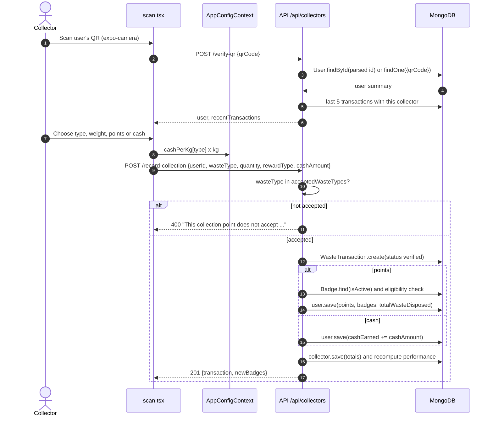
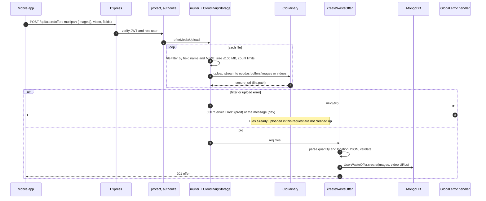
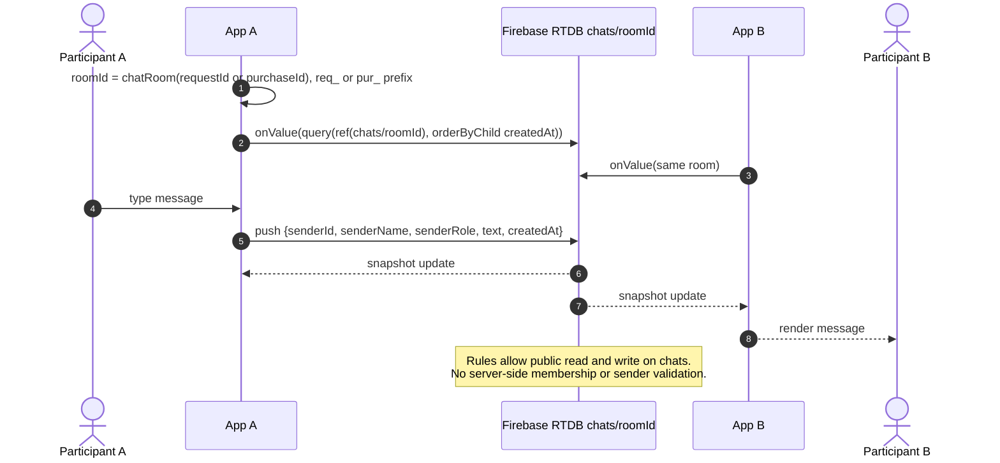

# EcoDash — API Architecture

Companion to [system-architecture.md](system-architecture.md) §9–10. Derived from [backend/server.js](../../backend/server.js) and [backend/routes/](../../backend/routes/) at commit `66d077c`. Evidence labels: **[V]** verified, **[I]** inferred, **[U]** unknown, **[R]** recommended.

## Conventions

| Aspect | Implementation |
|---|---|
| Base URL | `<host>/api`. The production host is hard-coded in [frontend/constants/config.ts](../../frontend/constants/config.ts) and [my-app/lib/api.ts](../../my-app/lib/api.ts). On Vercel every path is rewritten to the single `/api` function ([backend/vercel.json](../../backend/vercel.json)). [V] |
| Format | JSON (`express.json` limit 50 kB). Multipart for media routes. [V] |
| Auth header | `Authorization: Bearer <JWT>` (HS256, `{id, role}`) [V] |
| Envelope | `{ success: boolean, data?: any, message?: string }`, plus `token` on login and register, `count` on lists, and paging fields on admin transactions. [V] |
| Versioning | None [V] |
| Machine-readable spec | None (no OpenAPI) [V] |
| Pagination | `GET /admin/transactions` (`page`, `limit` ≤ 200, default 50) and `GET /users/leaderboard` (`limit` ≤ 200). All other lists are unbounded. [V] |
| Rate limiting | `authLimiter` on 5 public auth routes: 10 requests per 15 minutes per IP, `RateLimit-*` headers, 429 with the envelope. [V] |
| CORS | Allowlist of 4 origins. Requests with no `Origin` are allowed. Methods GET/POST/PUT/DELETE/PATCH/OPTIONS. [V] |
| Static | `GET /uploads/*` served from `backend/uploads/` (directory empty at baseline) [V] |

**Guard legend** used in the inventory: **Public** = no auth. **R** = rate limited. **P** = `protect`. **U / C / V** = `authorize('user'|'collector'|'vendor')`. **A** = `authorize('admin','superadmin')`. `perm:` = `requirePermission(...)` (any of the listed keys). **Client:** M = mobile app, Po = admin portal, — = no reference found in `frontend/` or `my-app/` [V].

## Endpoint inventory

### Root and public

| Method | Path | Purpose | Guard | Handler | Client |
|---|---|---|---|---|---|
| GET | `/` | Static API info / liveness (no DB check) | Public | inline, `server.js` | — |
| GET | `/api/config` | Merged runtime config (categories, rates, limits, FAQ, support contact) | Public | inline, `routes/config.js` | M |

### `/api/auth` — [backend/routes/auth.js](../../backend/routes/auth.js) → `authController`

| Method | Path | Purpose | Guard | Handler | Client |
|---|---|---|---|---|---|
| POST | `/api/auth/register` | Register user, collector or vendor; returns a JWT | Public, R | `register` | M |
| POST | `/api/auth/register/user` | Legacy user registration | Public, R | `registerUser` | — |
| POST | `/api/auth/login` | Login for any role (incl. admin) | Public, R | `login` | M, Po |
| POST | `/api/auth/forgot-password` | Email a 6-digit reset code | Public, R | `forgotPassword` | M, Po |
| POST | `/api/auth/reset-password` | Reset password with the code | Public, R | `resetPassword` | M, Po |
| GET | `/api/auth/me` | Current account | P | `getMe` | M |
| PUT | `/api/auth/update-profile` | Edit name, phone (+ address for users) | P | `updateProfile` | M |
| PUT | `/api/auth/change-password` | Change password | P | `changePassword` | M |
| PUT | `/api/auth/profile-photo` | Upload a profile photo (multipart `photo`, ≤5 MB) | P + `profilePhotoUpload` | `setProfilePhoto` | M |
| DELETE | `/api/auth/profile-photo` | Remove the profile photo | P | `removeProfilePhoto` | M |

### `/api/users` — [backend/routes/users.js](../../backend/routes/users.js) → `userController` (all P + U)

| Method | Path | Purpose | Handler | Client |
|---|---|---|---|---|
| GET | `/api/users/dashboard` | User stats | `getDashboard` | M |
| GET | `/api/users/collection-points` | Active, verified collectors (optional `wasteType`). No geo filter. | `getNearbyCollectors` | M |
| GET | `/api/users/transactions` | Own drop-off history | `getMyTransactions` | — |
| GET | `/api/users/rewards` | Available rewards | `getAvailableRewards` | M |
| POST | `/api/users/rewards/:rewardId/redeem` | Redeem a reward for a code | `redeemReward` | M |
| GET | `/api/users/redemptions` | Own redemptions | `getMyRedemptions` | M |
| GET | `/api/users/challenges` | Active challenges | `getActiveChallenges` | — |
| POST | `/api/users/challenges/:challengeId/join` | Join a challenge | `joinChallenge` | — |
| GET | `/api/users/leaderboard` | Leaderboard (`period`, `limit`) | `getLeaderboard` | M |
| GET | `/api/users/badges` | Own badges | `getMyBadges` | — |
| POST | `/api/users/offers` | Create a waste offer (multipart images ≤5, video ≤1) | `offerMediaUpload` → `createWasteOffer` | M |
| GET | `/api/users/offers` | Own offers | `getMyOffers` | M |
| DELETE | `/api/users/offers/:id` | Cancel own offer (sets `cancelled`) | `deleteWasteOffer` | M |
| GET | `/api/users/purchase-requests` | Bids from collectors | `getPurchaseRequests` | M |
| PUT | `/api/users/purchase-requests/:id` | Accept or reject a bid | `respondToPurchaseRequest` | M |
| POST | `/api/users/rate-collector` | Rate a collector after a completed pickup | `rateCollector` | M |

### `/api/collectors` — [backend/routes/collectors.js](../../backend/routes/collectors.js) → `collectorController` (all P + C)

| Method | Path | Purpose | Handler | Client |
|---|---|---|---|---|
| GET | `/api/collectors/dashboard` | Collector stats (also refreshes the performance score) | `getDashboard` | M |
| POST | `/api/collectors/verify-qr` | Resolve a scanned QR to a user summary | `getUserByQR` | M |
| POST | `/api/collectors/verify-dropoff` | Record a verified drop-off | `verifyDropoff` | — |
| POST | `/api/collectors/record-collection` | Alias of verify-dropoff | `verifyDropoff` | M |
| GET | `/api/collectors/transactions` | Own drop-off history | `getTransactions` | — |
| GET | `/api/collectors/reports` | Reports | `getReports` | — |
| GET | `/api/collectors/inventory` | Inventory derived from drop-offs and vendor deals | `getInventory` | M |
| GET | `/api/collectors/vendors` | Active vendors | `getVendors` | M |
| PUT | `/api/collectors/profile` | Edit collector profile fields | `updateProfile` | M |
| POST | `/api/collectors/offers` | Create an offer to vendors (multipart) | `offerMediaUpload` → `createOffer` | M |
| GET | `/api/collectors/offers` | Own offers | `getOffers` | M |
| PUT | `/api/collectors/offers/:id` | Update an offer | `updateOffer` | — |
| DELETE | `/api/collectors/offers/:id` | **Hard-delete** an offer | `deleteOffer` | M |
| GET | `/api/collectors/purchase-requests` | Vendor purchase requests | `getPurchaseRequests` | M |
| PUT | `/api/collectors/purchase-requests/:id/accept` | Accept → offer `sold` | `acceptPurchaseRequest` | M |
| PUT | `/api/collectors/purchase-requests/:id/reject` | Reject → offer `available` | `rejectPurchaseRequest` | M |
| PUT | `/api/collectors/purchase-requests/:id/counter` | Counter-offer price | `counterOffer` | — |
| PUT | `/api/collectors/purchase-requests/:id/complete` | Mark delivered | `completePurchase` | M |
| GET | `/api/collectors/user-offers` | Browse users' available offers | `browseUserOffers` | M |
| POST | `/api/collectors/user-offers/:offerId/request` | Bid on a user offer | `createUserPurchaseRequest` | M |
| GET | `/api/collectors/user-purchase-requests` | Own bids | `getMyUserPurchaseRequests` | M |
| PUT | `/api/collectors/user-purchase-requests/:requestId/complete` | Complete pickup and pay the user | `completeUserWastePickup` | M |
| DELETE | `/api/collectors/user-purchase-requests/:requestId` | Cancel a pending bid | `cancelUserPurchaseRequest` | M |
| POST | `/api/collectors/rate-vendor` | Rate a vendor after a completed sale | `rateVendor` | M |

### `/api/vendors` — [backend/routes/vendors.js](../../backend/routes/vendors.js) → `vendorController` (all P + V)

| Method | Path | Purpose | Handler | Client |
|---|---|---|---|---|
| GET | `/api/vendors/dashboard` | Vendor stats | `getDashboard` | M |
| POST | `/api/vendors/rewards` | Create a reward | `createReward` | — |
| GET | `/api/vendors/rewards` | Own rewards | `getMyRewards` | — |
| PUT | `/api/vendors/rewards/:id` | Update a reward | `updateReward` | — |
| DELETE | `/api/vendors/rewards/:id` | Deactivate a reward (soft) | `deleteReward` | — |
| GET | `/api/vendors/redemptions` | Redemptions of own rewards | `getRedemptions` | — |
| POST | `/api/vendors/redemptions/:code/verify` | Mark a redemption code used | `verifyRedemption` | — |
| GET | `/api/vendors/analytics` | Vendor analytics | `getAnalytics` | — |
| PUT | `/api/vendors/profile` | Edit vendor profile fields | `updateProfile` | M |
| GET | `/api/vendors/offers` | Browse collectors' available offers | `getOffers` | M |
| POST | `/api/vendors/purchase` | Create a purchase request (reserves the offer) | `purchaseWaste` | M |
| GET | `/api/vendors/purchases` | Own purchases (`status`) | `getPurchases` | M |
| PUT | `/api/vendors/purchases/:id/cancel` | Cancel a pending or accepted purchase | `cancelPurchase` | M |
| GET | `/api/vendors/inventory` | Purchases + completed totals by type | `getVendorInventory` | M |
| GET | `/api/vendors/pricing` | Own price list (created on first read) | `getPricing` | M |
| PUT | `/api/vendors/pricing` | Update price list | `updatePricing` | M |

### `/api/admin` — [backend/routes/admin.js](../../backend/routes/admin.js) → `adminController` / `adminAccessController` (all P + A)

| Method | Path | Purpose | Permission | Handler | Client |
|---|---|---|---|---|---|
| GET | `/api/admin/me` | Own role and effective permissions | (any admin) | `getMyAccess` | Po |
| GET | `/api/admin/dashboard` | Platform stats (`month`, `year`) | `dashboard.view` | `getDashboard` | Po |
| GET | `/api/admin/users` | List users (`search`, `status`) | `users.view` | `getUsers` | Po |
| PUT | `/api/admin/users/:id/status` | Activate or deactivate + email | `users.deactivate` | `updateUserStatus` | Po |
| PUT | `/api/admin/users/:id` | Edit name, phone (`isActive` also needs `users.deactivate`) | `users.edit` | `updateUser` | Po |
| DELETE | `/api/admin/users/:id` | Soft-delete + anonymise + email | `users.delete` | `deleteUser` | Po |
| POST | `/api/admin/collectors` | Create collector + welcome email | `collectors.create` | `createCollector` | Po |
| GET | `/api/admin/collectors` | List collectors | `collectors.view` | `getCollectors` | Po |
| PUT | `/api/admin/collectors/:id` | Edit collector (`isActive` needs `.deactivate`) | `collectors.edit` | `updateCollector` | Po |
| DELETE | `/api/admin/collectors/:id` | Soft-delete collector | `collectors.delete` | `deleteCollector` | Po |
| POST | `/api/admin/vendors` | Create vendor + welcome email | `vendors.create` | `createVendor` | Po |
| GET | `/api/admin/vendors` | List vendors | `vendors.view` | `getVendors` | Po |
| PUT | `/api/admin/vendors/:id` | Edit vendor | `vendors.edit` | `updateVendor` | Po |
| DELETE | `/api/admin/vendors/:id` | Soft-delete vendor | `vendors.delete` | `deleteVendor` | Po |
| POST | `/api/admin/challenges` | Create challenge | `rewards.manage` | `createChallenge` | — |
| GET | `/api/admin/challenges` | List challenges | `rewards.manage` | `getChallenges` | — |
| PUT | `/api/admin/challenges/:id` | Update challenge | `rewards.manage` | `updateChallenge` | — |
| POST | `/api/admin/badges` | Create badge | `rewards.manage` | `createBadge` | — |
| GET | `/api/admin/badges` | List badges | `rewards.manage` | `getBadges` | — |
| GET | `/api/admin/analytics` | Drop-off analytics (`startDate`, `endDate`) | `analytics.view` | `getAnalytics` | — |
| GET | `/api/admin/config` | All config (seeds defaults if empty) | `config.view` or `content.view` | `getAppConfig` | Po |
| PUT | `/api/admin/config` | Upsert one key (handler re-checks `content.edit` or `config.edit` per key) | `config.edit` or `content.edit` | `updateAppConfig` | Po |
| GET | `/api/admin/transactions` | Paged transactions by `type` (`dropoff`, `user-sale`, `vendor-sale`, `redemption`) | `transactions.view` | `getTransactions` → `services/adminTransactions.listTransactions` | Po |
| GET | `/api/admin/roles` | List roles | `roles.manage` or `admins.manage` | `getRoles` | Po |
| POST | `/api/admin/roles` | Create a custom role | `roles.manage` | `createRole` | Po |
| PUT | `/api/admin/roles/:id` | Rename or edit permissions (not Executive or built-in names) | `roles.manage` | `updateRole` | Po |
| DELETE | `/api/admin/roles/:id` | Delete a custom role | `roles.manage` | `deleteRole` | Po |
| GET | `/api/admin/admins` | List admins (migrates role-less admins to Executive) | `admins.manage` | `getAdmins` | Po |
| POST | `/api/admin/admins` | Create an admin with a temporary password + email | `admins.manage` | `createAdmin` | Po |
| PUT | `/api/admin/admins/:id` | Change role or status (last-Executive and self guards) | `admins.manage` | `updateAdmin` | Po |

### `/api/chat` — [backend/routes/chat.js](../../backend/routes/chat.js) (legacy)

| Method | Path | Purpose | Guard | Handler | Client |
|---|---|---|---|---|---|
| GET | `/api/chat/history/:roomId` | Last 100 Mongo chat messages; caller must be a participant of `req_`/`pur_` room | P + inline participant check | inline | — |

**Totals:** auth 10 · users 16 · collectors 24 · vendors 16 · admin 30 · chat 1 · config 1 = **98** route definitions, plus `GET /`. [V] This was reconciled against `router.<method>(` occurrences.

### Socket.IO events (legacy, not used by any client) [V]
Handshake `auth.token` = JWT. Client → server: `join_room {roomId}`, `leave_room {roomId}`, `send_message {roomId, text}`. Server → client: `new_message`, `message_error`. **`join_room` has no membership check.** Any authenticated account can join any room and receive its messages. [V] [backend/socket/chatHandler.js](../../backend/socket/chatHandler.js)

## Request and response formats (representative)

```jsonc
// POST /api/auth/login  (request)
{ "email": "…", "password": "…", "role": "user|collector|vendor|admin" }
// 200
{ "success": true, "token": "<JWT>", "data": { "_id": "…", "name": "…", "email": "…", "role": "user", "points": 0, "cashEarned": 0, "qrCode": "data:image/png;base64,…" } }
// error
{ "success": false, "message": "Invalid credentials" }

// GET /api/admin/transactions?type=dropoff&page=1&limit=50  (200)
{ "success": true, "type": "dropoff", "data": [ /* rows */ ], "total": 0, "page": 1, "limit": 50, "pages": 1,
  "statuses": ["pending","verified","rejected"], "summary": { "total": 0, "byStatus": {} }, "countsByType": {}, "count": 0 }
```

## Error model

| Source | Status | Body |
|---|---|---|
| Missing or invalid input in controllers | 400 | `{success:false, message}` |
| `protect`: no or invalid token, expired, password changed, account deleted | 401 | same |
| `protect`: account deactivated | 403 | same |
| `protect`: account not found | 404 | same |
| `authorize` | 403 | `Role 'x' is not authorized to access this route` |
| `requirePermission` | 403 | `You don't have permission to <label>` |
| Rate limit | 429 | `Too many attempts, please try again later.` |
| Controller `catch` | 500 | `message: error.message` (**not hidden in production**) |
| Global error handler (multer errors, CORS rejection, thrown errors) | `err.status` or 500 | `Server Error` in production, otherwise the message |
| Profile photo upstream failure | 502 | `Could not upload the photo: …` |

Mobile behaviour: [frontend/services/api.ts](../../frontend/services/api.ts) rejects with the server body (or a string for network errors) and clears stored auth on **401 only**. [V]

## Request flow sequences

### QR drop-off (collector scan)



### Offer media upload (with failure branch)



### Chat (client ↔ Firebase; the API is not involved)



## Recommendations [R]
- Publish an OpenAPI document, generated from request schemas (zod or express-validator, which is already a dependency).
- Add `/v1` and a deprecation process before removing the unused endpoints listed with "—".
- Return generic 500 messages in production. Add a request id for log correlation.
- Add pagination to every list endpoint. Add idempotency keys to `record-collection`, `redeem` and `complete` endpoints.
