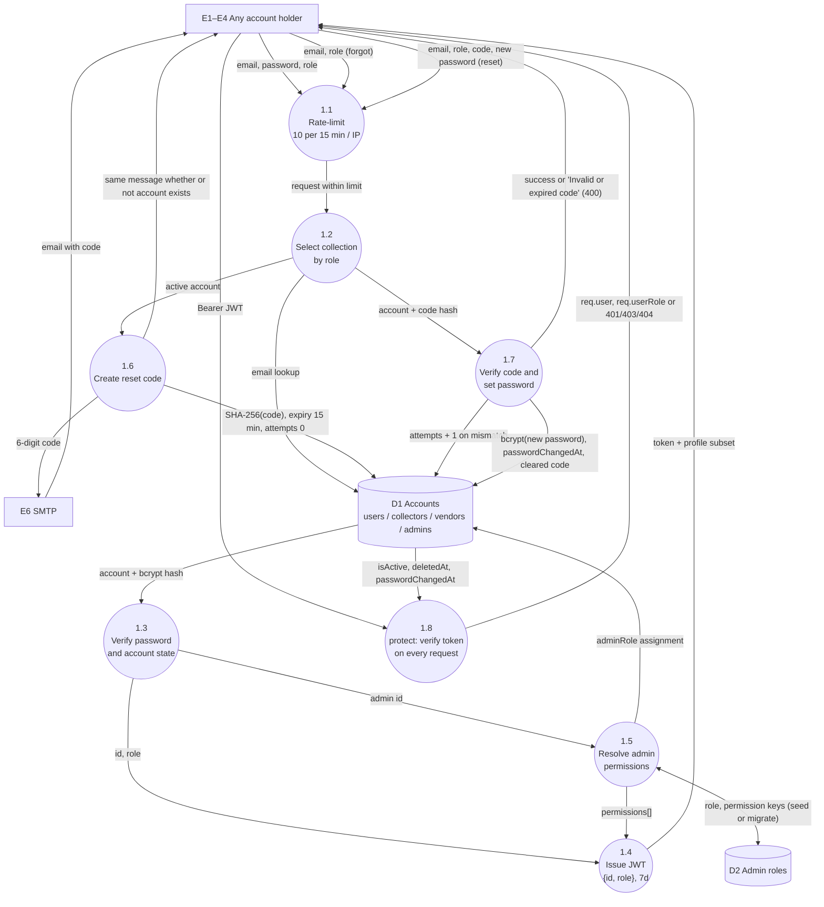
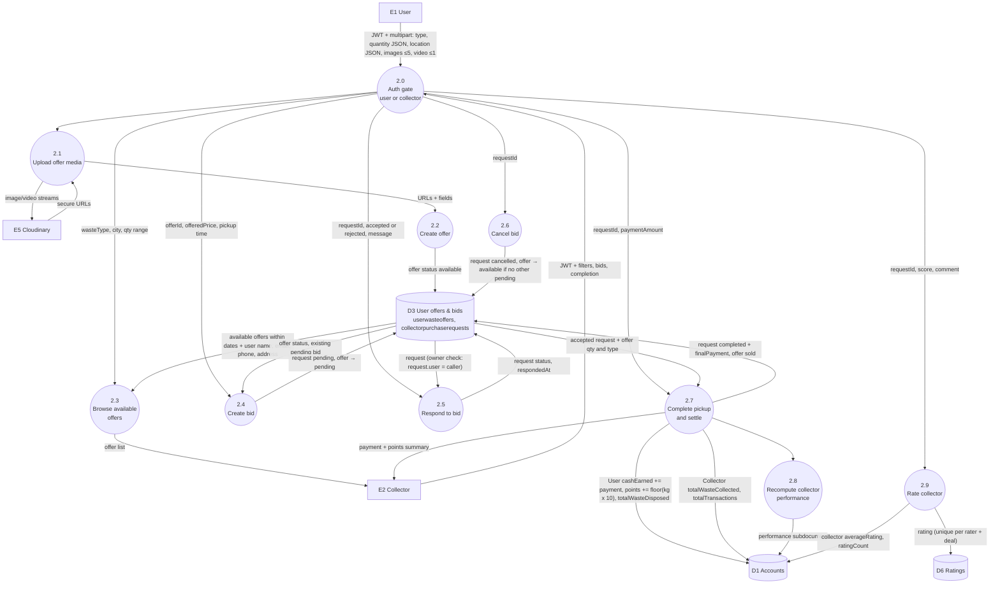
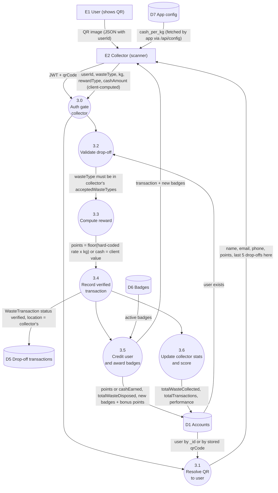
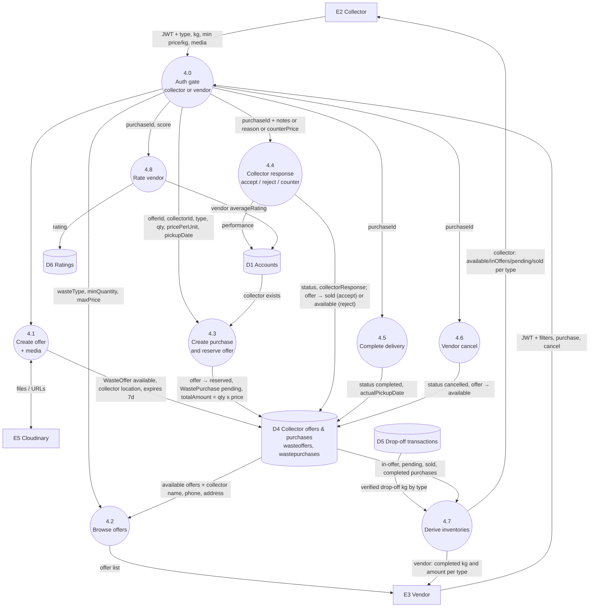
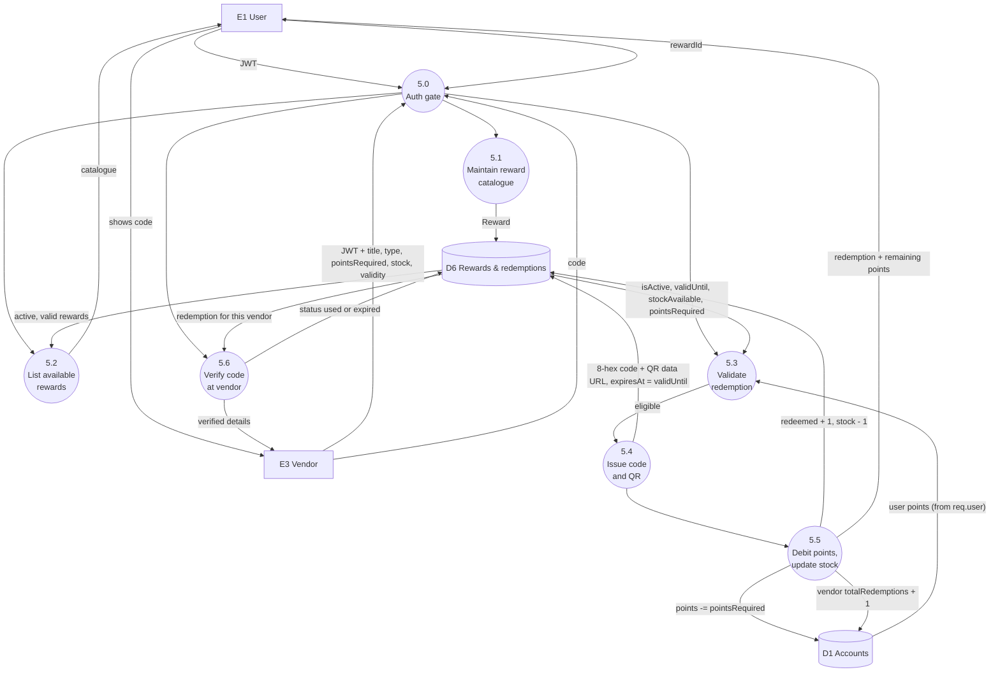

# EcoDash — Data Flow Diagrams (detail)

Companion to [system-architecture.md](system-architecture.md) §7–8, which holds the **Level 0** and **Level 1** diagrams and the identifier tables. This file holds the **Level 2** decompositions. Evidence labels: **[V]** verified in code, **[I]** inferred, **[U]** unknown, **[R]** recommended.

## Notation

| Shape | Meaning | IDs |
|---|---|---|
| `[ Rectangle ]` | External entity: a person or system outside EcoDash | E1 User · E2 Collector · E3 Vendor · E4 Admin · E5 Cloudinary · E6 SMTP · E7 Firebase RTDB |
| `(( Circle ))` | Process. Level 2 IDs are `<parent>.<n>`, e.g. 2.4 | P1–P6 at Level 1 |
| `[( Cylinder )]` | Data store | D1 Accounts · D2 Admin roles · D3 User offers & bids · D4 Collector offers & purchases · D5 Drop-off transactions · D6 Rewards/redemptions/challenges/badges/ratings · D7 App config & vendor pricing · D8 Media (Cloudinary assets, drawn as E5) |
| Arrow with label | The data that moves (not a control signal) | — |
| `{ Diamond }` | Decision inside a process, used sparingly | — |

Every Level-2 diagram starts with the same authentication and authorisation gate, **protect → authorize(role)**, described in 2-A. For brevity, later diagrams show it as a single process named "Auth gate".

---

## 2-A Authentication & password reset

Decomposes **P1**. Sources: [backend/routes/auth.js](../../backend/routes/auth.js), [backend/controllers/authController.js](../../backend/controllers/authController.js), [backend/middleware/auth.js](../../backend/middleware/auth.js), [backend/models/plugins/passwordReset.js](../../backend/models/plugins/passwordReset.js), [backend/utils/email.js](../../backend/utils/email.js).

| Process | Validation and authorisation | Notes |
|---|---|---|
| 1.1 | express-rate-limit, in-memory store | Per serverless instance [I] |
| 1.3 | bcrypt compare. `isActive` must be true (403). | Email is not lower-cased on login [V] |
| 1.4 | — | `JWT_EXPIRE` default 7d. No refresh token. |
| 1.5 | Executive gets every key. Role-less admins are migrated to Executive. | Runs once per process for seeding |
| 1.6 | Only for existing **active** accounts | If the email send fails, the code is cleared [V] |
| 1.7 | Expiry, ≤5 attempts, `crypto.timingSafeEqual` | `passwordChangedAt` back-dated 1 s so a fresh login is accepted |
| 1.8 | HS256 pinned. Account exists, not deleted (401), active (403), `iat` ≥ `passwordChangedAt` (401). | `changePassword` does not set `passwordChangedAt` [V] |

---

## 2-B User → collector deal lifecycle

Decomposes **P2**. Sources: `userController.createWasteOffer / getMyOffers / getPurchaseRequests / respondToPurchaseRequest / deleteWasteOffer / rateCollector`, `collectorController.browseUserOffers / createUserPurchaseRequest / getMyUserPurchaseRequests / completeUserWastePickup / cancelUserPurchaseRequest`, [backend/middleware/upload.js](../../backend/middleware/upload.js).

**Data transformations**
- Multipart fields `quantity` and `location` arrive as JSON strings and are parsed. Invalid JSON returns 400. [V]
- `finalPayment = paymentAmount ‖ proposedPrice ‖ offeredPrice`. Points are fixed at `floor(kg × 10)`, independent of waste type and of AppConfig. [V]
- The `collector.inventory[...]` increment in 2.7 targets a path that is not in the schema. It is **not persisted** [I], and the collector inventory screen never reflects these pickups. [V]

**Behaviour and gaps** [V]:
- 2.4 moves the offer to `pending`, and 2.4 also requires `available`. So **only one collector can have a bid open on an offer at a time**: the marketplace is first-come, not competitive bidding.
- 2.5 *reject* leaves the offer `pending`. No other collector can then bid, and browse hides it. The offer is stuck until the user cancels it (`DELETE /users/offers/:id`).
- There is no transaction around 2.7.

---

## 2-C QR drop-off

Decomposes **P3**. Sources: `collectorController.getUserByQR`, `collectorController.verifyDropoff` (mounted at `/verify-dropoff` and `/record-collection`), [backend/utils/helpers.js](../../backend/utils/helpers.js), [frontend/app/(collector-tabs)/scan.tsx](../../frontend/app/%28collector-tabs%29/scan.tsx).

**Trust issues** [V]: `cashAmount` is accepted from the client without being bounded or recomputed. `userId` is any ObjectId, and the user's `isActive`/`deletedAt` are not checked. The QR payload is unsigned JSON. There is no idempotency, so a repeated submit creates a second transaction. Points use the hard-coded table in `helpers.calculatePoints`, not D7.

---

## 2-D Collector → vendor purchase

Decomposes **P4**. Sources: `collectorController.createOffer / getOffers / updateOffer / deleteOffer / getPurchaseRequests / acceptPurchaseRequest / rejectPurchaseRequest / counterOffer / completePurchase / getInventory / rateVendor`, `vendorController.getOffers / purchaseWaste / getPurchases / cancelPurchase / getVendorInventory`.

**Gaps** [V]: in 4.3, the server does not check that `offerId` belongs to `collectorId`, or that `quantity` ≤ the offered quantity. The price is vendor-supplied. 4.4 has no vendor-side path to accept a counter-offer. 4.6 releases the offer even if it is already `sold`. The collector's `DELETE /offers/:id` hard-deletes the offer whatever its status. 4.7 collector inventory excludes marketplace pickups (2-B).

---

## 2-E Reward redemption

Decomposes the rewards part of **P5**. Sources: `vendorController.createReward / updateReward / deleteReward / getRedemptions / verifyRedemption`, `userController.getAvailableRewards / redeemReward / getMyRedemptions`, `helpers.generateRedemptionCode / generateRedemptionQRCode`.

**Consistency** [I]: 5.3 and 5.5 are check-then-act on `req.user.points` and `stockAvailable`. Parallel redemptions can overdraw points or stock. The vendor reward and redemption endpoints have no client reference in the mobile app [V], so 5.1 and 5.6 may be unused in practice.

---

## 2-F Admin account deletion with RBAC

Decomposes the account-management part of **P6**, plus per-key configuration editing because it shares the same permission mechanism. Sources: [backend/routes/admin.js](../../backend/routes/admin.js), [backend/middleware/auth.js](../../backend/middleware/auth.js) `requirePermission`, [backend/services/adminAccess.js](../../backend/services/adminAccess.js), [backend/services/accountDeletion.js](../../backend/services/accountDeletion.js), `adminController.updateAppConfig`.

```mermaid
flowchart TB
    E4["E4 Admin (portal)"]
    E6["E6 SMTP"]
    EX["Deleted account's owner"]
    D1[("D1 Accounts")]
    D2[("D2 Admin roles")]
    D3[("D3 User offers & bids")]
    D4[("D4 Collector offers & purchases")]
    D6[("D6 Rewards")]
    D7[("D7 App config")]

    P61(("6.1<br/>protect +<br/>authorize admin"))
    P62(("6.2<br/>Resolve role<br/>permissions"))
    P63(("6.3<br/>Check permission<br/>x.delete"))
    P64(("6.4<br/>Cancel open items"))
    P65(("6.5<br/>Anonymise and<br/>revoke sessions"))
    P66(("6.6<br/>Notify owner"))
    P67(("6.7<br/>Per-key config<br/>permission + upsert"))

    E4 -->|"JWT + DELETE /admin/users or collectors or vendors/:id, reason"| P61
    D1 -->|"admin account"| P61
    P61 --> P62
    D2 -->|"role, isExecutive, permission keys"| P62
    P62 -->|"permissions[] cached on req"| P63
    P63 -->|"403 'You don't have permission to ...'"| E4
    P63 -->|"allowed"| P64
    D1 -->|"target not already deleted"| P64
    P64 -->|"user: offers and bids cancelled"| D3
    P64 -->|"collector: offers, bids, purchases cancelled. Vendor: purchases cancelled"| D4
    P64 -->|"vendor rewards isActive false"| D6
    P64 --> P65
    P65 -->|"name 'Deleted role', email deleted-id@deleted.invalid, phone '', random password, personal fields unset, isActive false, deletedAt, passwordChangedAt"| D1
    P65 --> P66
    D7 -->|"support_contact"| P66
    P66 -->|"deletion notice + reason (≤500 chars)"| E6
    E6 --> EX
    P66 -->|"{name, email, emailSent}"| E4

    E4 -->|"JWT + PUT /admin/config {key, value}"| P61
    P62 -->|"permissions[]"| P67
    P67 -->|"content.edit for faq_items/support_contact, else config.edit"| D7
```

**Ordering note** [V]: 6.4 runs before 6.5, so open deals are closed before the account becomes unreachable. Neither step is transactional. A failure in 6.5 after 6.4 leaves cancelled deals on a still-active account.
