# EcoDash — Database and Data Model

Companion to [system-architecture.md](system-architecture.md) §11. Everything here is taken from [backend/models/](../../backend/models/) at commit `66d077c`. Evidence labels: **[V]** verified, **[I]** inferred, **[U]** unknown, **[R]** recommended.

## Engine and conventions
- **MongoDB** accessed through **Mongoose 8.19.3**. The connection is opened by [backend/config/db.js](../../backend/config/db.js) from `MONGODB_URI`. [V]
- Every schema except the `Challenge.participants` subdocuments has `timestamps: true`, giving `createdAt` and `updatedAt`. [V]
- References are `ObjectId` + `ref`. **MongoDB does not enforce them.** There are no cascades, and integrity is maintained by application code (or not at all). [V]
- Collection names follow Mongoose's pluralised lowercase convention, e.g. `CollectorPurchaseRequest` → `collectorpurchaserequests`. [I] This is the default; no model overrides it.
- Indexes are declared in schemas and built by Mongoose `autoIndex`. Whether they exist in production is [U].
- There is no migration tool. Schema changes take effect on deploy, and existing documents are handled with defaults or `validateBeforeSave: false` (see the comments in `authController`). [V]
- `backend/models/UserOffer.js` is an **empty file**. It defines no model and nothing imports it. [V]
- Nested fields such as `quantity.value` are shown in the ERD as `quantity_value`, because Mermaid attribute names cannot contain dots.

## Full ERD

```mermaid
erDiagram
    USER {
        ObjectId _id PK
        string name
        string email UK "lowercase, regex"
        string password "bcrypt, select false"
        string phone
        object address "street, city, state, zipCode"
        string profileImage "Cloudinary URL"
        number points
        number cashEarned
        number totalWasteDisposed
        ObjectId_array badges FK "Badge"
        string qrCode UK "sparse, PNG data URL"
        string role "enum user"
        date deletedAt
        boolean isActive
        string resetPasswordCode "sha256, select false"
        date resetPasswordExpire
        number resetPasswordAttempts
        date passwordChangedAt
    }
    COLLECTOR {
        ObjectId _id PK
        string name
        string email UK
        string password
        string phone "required"
        object address "street and city required"
        point location "2dsphere, required coords"
        object operatingHours "per weekday open, close"
        string_array acceptedWasteTypes "enum of 7"
        string profileImage
        string description
        number totalWasteCollected
        number totalTransactions
        date deletedAt
        boolean isActive
        boolean isVerified "default TRUE"
        ObjectId verifiedBy FK "Admin"
        number averageRating
        number ratingCount
        object performance "score, collectionsLast30Days, completionRate, avgResponseHours, computedAt"
    }
    VENDOR {
        ObjectId _id PK
        string name
        string email UK
        string password
        string phone "required"
        string logo "profile photo URL"
        string description
        string businessType "Physical Store, Online, Both"
        object address
        string website
        point location "2dsphere, optional"
        number totalRewards
        number totalRedemptions
        number uniqueUsers
        date deletedAt
        boolean isActive
        boolean isVerified "default false"
        ObjectId verifiedBy FK "Admin"
        number averageRating
        number ratingCount
    }
    ADMIN {
        ObjectId _id PK
        string name
        string email UK
        string password
        string role "legacy, not read"
        string_array permissions "legacy, not read"
        ObjectId adminRole FK "AdminRole"
        boolean isActive
    }
    ADMIN_ROLE {
        ObjectId _id PK
        string name UK
        string key UK "executive, manager, admin or slug"
        string description
        string_array permissions
        string_array seededPermissions
        boolean isSystem
        boolean isExecutive
    }
    USER_WASTE_OFFER {
        ObjectId _id PK
        ObjectId user FK
        string wasteType "enum of 7"
        number quantity_value
        string quantity_unit "kg, pieces, items, bags"
        string description
        string_array images
        string video
        number expectedPrice
        object location "address, city, coordinates 2dsphere"
        string status "available, pending, sold, cancelled"
        date availableFrom
        date availableUntil
        string pickupPreference
    }
    COLLECTOR_PURCHASE_REQUEST {
        ObjectId _id PK
        ObjectId userOffer FK
        ObjectId collector FK
        ObjectId user FK
        number offeredPrice
        number proposedPrice
        number finalPayment
        string message
        date proposedPickupTime
        string status "pending, accepted, rejected, completed, cancelled"
        date respondedAt
        date completedAt
        string userResponse
        boolean userRated
    }
    WASTE_TRANSACTION {
        ObjectId _id PK
        ObjectId user FK
        ObjectId collector FK
        string wasteType
        number quantity_value
        string quantity_unit "kg, items, bags"
        number pointsEarned
        string rewardType "points, cash"
        number cashAmount
        string status "pending, verified, rejected"
        string verificationImage
        boolean qrCodeScanned
        string notes
        date verifiedAt
        point location
    }
    WASTE_OFFER {
        ObjectId _id PK
        ObjectId collector FK
        string wasteType
        number quantity_value "min 0"
        string quantity_unit
        number minPricePerKg "min 0"
        string description "max 500"
        string status "available, reserved, sold, cancelled"
        date expiresAt "default now + 7d"
        point location "2dsphere"
        string_array images
        string video
    }
    WASTE_PURCHASE {
        ObjectId _id PK
        ObjectId vendor FK
        ObjectId collector FK
        ObjectId offer FK "optional"
        string wasteType
        number quantity_value
        number pricePerUnit
        number totalAmount
        string status "pending, accepted, rejected, completed, cancelled"
        object collectorResponse "status, message, counterPrice, respondedAt"
        date pickupDate
        date actualPickupDate
        string vendorNotes
        string collectorNotes
        point location "2dsphere"
        boolean collectorRated
    }
    REWARD {
        ObjectId _id PK
        ObjectId vendor FK
        string title
        string description
        string type "Discount, Free Item, Coupon, Voucher, Eco-Product"
        number pointsRequired "min 0"
        number discountPercentage "0-100"
        number discountAmount
        number stockAvailable "null = unlimited"
        number redeemed
        date validFrom
        date validUntil
        boolean isActive
        string category
    }
    REWARD_REDEMPTION {
        ObjectId _id PK
        ObjectId user FK
        ObjectId reward FK
        ObjectId vendor FK
        number pointsUsed
        string redemptionCode UK
        string qrCode "PNG data URL"
        string status "active, used, expired"
        date usedAt
        date expiresAt
    }
    CHALLENGE {
        ObjectId _id PK
        string title
        string type "Daily, Weekly, Monthly, Special"
        object goal "wasteType, targetQuantity, unit"
        number reward_points
        ObjectId reward_badge FK "Badge"
        date startDate
        date endDate
        boolean isActive
    }
    CHALLENGE_PARTICIPANT {
        ObjectId user FK "embedded in Challenge.participants"
        number progress
        boolean completed
        date completedAt
    }
    BADGE {
        ObjectId _id PK
        string name UK
        string icon
        string level "Bronze to Diamond"
        object criteria "type, threshold, wasteType"
        number points
        string rarity
        ObjectId_array earnedBy FK "User"
        boolean isActive
    }
    RATING {
        ObjectId _id PK
        ObjectId rater "polymorphic, no ref"
        string raterRole "user, collector"
        ObjectId ratee "polymorphic, no ref"
        string rateeRole "collector, vendor"
        number score "1-5"
        string comment "max 300"
        ObjectId relatedId "request or purchase id"
    }
    VENDOR_PRICING {
        ObjectId _id PK
        ObjectId vendor FK,UK
        object_array pricing "wasteType, pricePerKg, min, max, isActive"
        string currency "default USD"
        date lastUpdated
    }
    APP_CONFIG {
        ObjectId _id PK
        string key UK
        mixed value
        string description
        string category
    }
    CHAT_MESSAGE {
        ObjectId _id PK
        string roomId "indexed, req_ or pur_ prefix"
        string senderId
        string senderName
        string senderRole
        string text "max 500"
    }

    USER ||--o{ USER_WASTE_OFFER : "lists"
    USER_WASTE_OFFER ||--o{ COLLECTOR_PURCHASE_REQUEST : "userOffer"
    COLLECTOR ||--o{ COLLECTOR_PURCHASE_REQUEST : "collector"
    USER ||--o{ COLLECTOR_PURCHASE_REQUEST : "user"
    USER ||--o{ WASTE_TRANSACTION : "user"
    COLLECTOR ||--o{ WASTE_TRANSACTION : "collector"
    COLLECTOR ||--o{ WASTE_OFFER : "collector"
    WASTE_OFFER |o--o{ WASTE_PURCHASE : "offer"
    VENDOR ||--o{ WASTE_PURCHASE : "vendor"
    COLLECTOR ||--o{ WASTE_PURCHASE : "collector"
    VENDOR ||--o{ REWARD : "vendor"
    REWARD ||--o{ REWARD_REDEMPTION : "reward"
    USER ||--o{ REWARD_REDEMPTION : "user"
    VENDOR ||--o{ REWARD_REDEMPTION : "vendor"
    VENDOR ||--o| VENDOR_PRICING : "vendor (unique)"
    USER }o--o{ BADGE : "badges / earnedBy"
    CHALLENGE }o--o| BADGE : "reward.badge"
    CHALLENGE ||--o{ CHALLENGE_PARTICIPANT : "participants[]"
    USER ||--o{ CHALLENGE_PARTICIPANT : "user"
    ADMIN_ROLE ||--o{ ADMIN : "adminRole"
    ADMIN |o--o{ COLLECTOR : "verifiedBy"
    ADMIN |o--o{ VENDOR : "verifiedBy"
    COLLECTOR ||--o{ RATING : "ratee when rateeRole collector"
    VENDOR ||--o{ RATING : "ratee when rateeRole vendor"
```

`CHAT_MESSAGE` and `APP_CONFIG` have no references. Chat messages link to deals only through the `roomId` string convention (`req_<CollectorPurchaseRequest id>`, `pur_<WastePurchase id>`).

## Constraints: database-enforced versus application-level

| Rule | Enforced by | Evidence |
|---|---|---|
| Unique email **within** a role collection | DB unique index | `email: { unique: true }` in each account model |
| Unique email **across** roles | App, partially: `register` checks User, Collector and Vendor, but not Admin. `createCollector`/`createVendor` (admin) check only their own collection. | [V] `authController.register`, `adminController.createCollector` |
| One rating per rater per deal | DB unique `{rater, relatedId}` + app flags `userRated` / `collectorRated` | [V] `Rating.js` |
| Unique redemption code | DB unique index. The code is 4 random bytes; there is no retry on collision. | [V] |
| One pricing document per vendor | DB unique `vendor` | [V] |
| Enum values (status, waste types, units) | Mongoose validation on `create`/`save`. **Bypassed** by `updateOne`/`updateMany`/`findByIdAndUpdate` without `runValidators`. | [V] |
| Status transitions (state machines) | App only, by putting the expected status in the query, e.g. `{status:'pending'}` | [V] controllers |
| Reference integrity (offer exists, collector owns offer) | App only, and incomplete (see `purchaseWaste`) | [V] |
| Points ≥ 0, stock ≥ 0 | App check before decrement; not atomic | [V] / [I] race |
| Password hashing | Model `pre('save')` hook. Never runs for `updateOne`, which is why deletion hashes manually. | [V] |
| At least one active Executive | App (`adminAccessController`) | [V] |

## Collection lifecycle (CRUD paths)

| Collection | Created by | Updated by | Read by | Deleted by |
|---|---|---|---|---|
| users | `register`, `registerUser`, seed | profile, photo, password, points and cash (drop-off, pickup, redeem, badges), admin edit and status, deletion (anonymise) | most user endpoints, admin lists, leaderboard, QR lookup | never (soft) |
| collectors | `register` (public), admin `createCollector`, seed | profile, totals, performance, rating, admin, deletion | browse, maps, admin | never (soft) |
| vendors | `register` (public), admin `createVendor`, seed | profile, ratings, `totalRedemptions`, deletion | collector vendor list, admin | never (soft) |
| admins | `create-admin.js`, `adminAccessController.createAdmin`, seed | `updateAdmin`, role migration, password | `protect`, admin list | never |
| adminroles | `ensureDefaultRoles` (upsert), `createRole` | `updateRole`, default seeding | `resolveAdminAccess` | `deleteRole` (custom roles only, guarded) |
| userwasteoffers | `createWasteOffer` | status by bid, respond, cancel, complete, deletion | browse, my offers, dashboards | never (status `cancelled`) |
| collectorpurchaserequests | `createUserPurchaseRequest` | respond, cancel, complete, rating flag, deletion | both parties, admin dashboard and transactions, performance | never |
| wastetransactions | `verifyDropoff` | — | dashboards, inventory, analytics, leaderboard, performance | never |
| wasteoffers | `createOffer` | `updateOffer`, purchase reserve, sold or available, deletion | vendor browse, inventory | **hard delete** `deleteOffer` |
| wastepurchases | `purchaseWaste` | accept, reject, counter, complete, cancel, rating flag, deletion | both parties, inventories, admin transactions, performance | never |
| rewards | `createReward` | `updateReward`, redeem counters, account deletion deactivates | user catalogue, vendor | never (`deleteReward` sets `isActive:false`) |
| rewardredemptions | `redeemReward` | `verifyRedemption` | user, vendor, admin transactions | never |
| challenges / badges | admin `createChallenge` / `createBadge`, seed | `updateChallenge`, `joinChallenge`. Badges are awarded by pushing to `User.badges`. **`Badge.earnedBy` is never written.** | user endpoints | never |
| ratings | `rateCollector`, `rateVendor` | — | average recompute | never |
| vendorpricings | `getPricing` or `updatePricing` creates it on first use | `updatePricing` | vendor | never |
| appconfigs | `getAppConfig` seeds defaults when empty; `updateAppConfig` upsert | `updateAppConfig` | public `GET /api/config`, admin, support contact for emails | never |
| chatmessages | Socket.IO `send_message` (inactive path) | — | `GET /api/chat/history/:roomId` (no client) | never |

## Data lifecycle and retention
- **Soft deletion** for accounts ([backend/services/accountDeletion.js](../../backend/services/accountDeletion.js)). Personal fields removed per role: user `address, profileImage, qrCode`. Collector `address, profileImage, description, operatingHours`. Vendor `address, logo, description, website`. Points, totals, ratings and the collector's location (needed by the geo index) are kept. [V]
- **Expiry fields without sweepers:** `WasteOffer.expiresAt` (browse does not filter on it [V]), `RewardRedemption.expiresAt` (expired lazily at verification), `resetPasswordExpire` (checked at use). There are no TTL indexes or cron jobs. [V]
- **Media:** offer images and videos stay on Cloudinary forever. Profile photos are destroyed when replaced or removed. [V]
- **Backups and point-in-time recovery:** depend on the MongoDB hosting plan [U].

## Recommendations [R]
1. Add an inventory ledger, or a `source` field on `WasteTransaction`, so marketplace pickups count toward collector stock.
2. Use conditional atomic updates for points, stock and offer status, and transactions for multi-document flows.
3. Add indexes `{vendor, status}` and `{collector, status}` on `wastepurchases`, which are queried that way, and drop the duplicate 2dsphere declaration on `userwasteoffers`.
4. Add TTL or cleanup jobs for expired offers, redemptions and reset codes. Remove `UserOffer.js`.
5. Align `VendorPricing.currency` with LKR.
