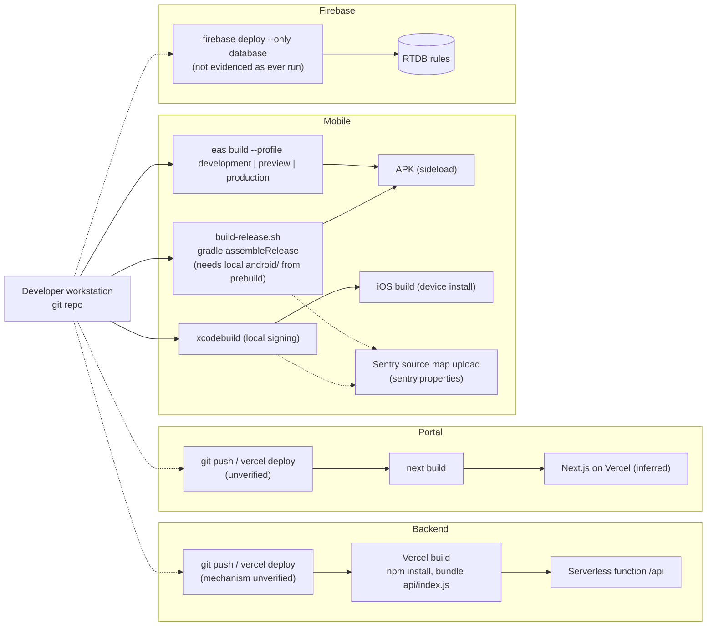

# EcoDash — Deployment and Infrastructure

Companion to [system-architecture.md](system-architecture.md) §14, which holds the deployment and network topology diagram. Evidence labels: **[V]** verified in repository, **[I]** inferred, **[U]** unknown (not verifiable from the repository), **[R]** recommended.

> No cloud console, Vercel project, Firebase project or database was accessed. Every hosting statement below comes from files in the repository.

## 1. What the repository proves

| Fact | Evidence |
|---|---|
| The backend is packaged for Vercel serverless: every path is rewritten to `/api`, which re-exports the Express app | [V] [backend/vercel.json](../../backend/vercel.json), [backend/api/index.js](../../backend/api/index.js) |
| `server.listen` is skipped when `NODE_ENV=production` **and** `VERCEL` is set | [V] [backend/server.js](../../backend/server.js) |
| Production backend host (`*.vercel.app`) is hard-coded in the mobile app, the portal API client and the portal rewrite | [V] [frontend/constants/config.ts](../../frontend/constants/config.ts), [my-app/lib/api.ts](../../my-app/lib/api.ts), [my-app/next.config.ts](../../my-app/next.config.ts) |
| A deployed admin portal origin (`*.vercel.app`) is in the CORS allowlist | [V] `server.js` `ALLOWED_ORIGINS` → portal on Vercel [I] |
| Mobile builds: EAS profiles `development` (dev client, internal, Android APK, iOS simulator), `preview` (internal APK), `production` (APK, `autoIncrement`); `appVersionSource: remote`; empty `submit.production` | [V] [frontend/eas.json](../../frontend/eas.json) |
| Local Android release build script (clean, Metro cache clear, Gradle `assembleRelease`, Hermes + ProGuard) | [V] [frontend/build-release.sh](../../frontend/build-release.sh), [frontend/app.json](../../frontend/app.json) |
| Native projects `frontend/android` and `frontend/ios` are **git-ignored** (`frontend/.gitignore`). They are generated locally (Expo prebuild) and exist only on developer machines, along with their `sentry.properties`. The Sentry Expo plugin is configured in `app.json`. | [V] `git ls-files`, `git check-ignore` |
| App identifiers: Android package and iOS bundle id `com.windsun.frontend`, version `1.0.0`, URL scheme `ecodash` | [V] `app.json` |
| Firebase RTDB rules are deployable with the Firebase CLI (`firebase.json` → `database.rules.json`) | [V] |
| **No CI/CD, containers or IaC**: no `.github/workflows`, `Dockerfile`, `docker-compose`, Terraform, or Vercel project config beyond rewrites | [V] repository search |

## 2. Environments

| Environment | Backend | Portal | Mobile | Database |
|---|---|---|---|---|
| Local | `npm run dev` on `PORT` (default 3000), Socket.IO active | `pnpm dev -p 3001` | `expo start` (Metro 8081), or `expo run:*` | Whatever `MONGODB_URI` points to [U] |
| Production | Vercel serverless function [V] | Vercel [I] | Sideloaded APK / dev-signed iOS builds [I]; no store submission configured [V] | MongoDB Atlas per CLAUDE.md [I] |
| Staging / test | **none** | **none** | EAS `preview` profile exists, but it uses the same hard-coded production API URL | **none** |

Switching the mobile app to a local backend means editing `API_URL` in source (there is a commented LAN URL). The same applies to `my-app/lib/api.ts`. [V]

## 3. Configuration by environment (names only)

| App | Variable | Required | Read in | Notes |
|---|---|---|---|---|
| backend | `MONGODB_URI` | yes | `config/db.js` | Process exits if the connection fails |
| backend | `JWT_SECRET` | yes | `config/jwt.js`, `middleware/auth.js`, `socket/chatHandler.js` | Must match the portal's |
| backend | `JWT_EXPIRE` | no (7d) | `config/jwt.js` | |
| backend | `PORT`, `NODE_ENV`, `VERCEL` | no | `server.js` | `VERCEL` is set by the platform |
| backend | `CLOUDINARY_URL` | yes for uploads | `middleware/upload.js` | **Missing from `.env.example`** |
| backend | `EMAIL_HOST`, `EMAIL_PORT`, `EMAIL_USER`, `EMAIL_PASS`, `EMAIL_FROM` | for email | `utils/email.js` | Emails skipped with a warning if user or pass is unset |
| backend | `ADMIN_URL` | no | `utils/email.js` (login link in the welcome email) | |
| backend | `MAX_FILE_SIZE`, `UPLOAD_PATH`, `CLIENT_URL` | — | **not read anywhere** | Stale entries in `.env.example` |
| backend scripts | `ADMIN_EMAIL`, `ADMIN_PASSWORD`, `ADMIN_NAME`, `ADMIN_ROLE` | for `create-admin.js` | `create-admin.js` | |
| my-app | `JWT_SECRET` | yes | `middleware.ts` | **Falls back to a hard-coded literal if unset** |
| my-app | `NEXT_PUBLIC_GOOGLE_MAPS_API_KEY` | for the collector map | `(admin)/collectors/page.tsx` | Public by design |
| my-app | `NEXT_PUBLIC_BACKEND_URL` | no | `next.config.ts` rewrite | The rewrite is unused because `lib/api.ts` calls the backend directly [I] |
| frontend | — | — | — | No env-driven configuration; all inlined |

## 4. Build and release workflow (as practised, inferred from files)

**What it shows:** the manual paths from source to running software. There is no automated pipeline. Dashed edges are steps whose mechanism is [U].

### Database changes during deployment
There is no migration step. [V] Mechanisms that run at runtime instead:
- `AppConfig` defaults are inserted by `GET /api/admin/config` when the collection is empty, and defaults are merged on read. [V]
- Built-in admin roles are upserted, and new default permissions granted, on the first admin request per process (`ensureDefaultRoles`). [V]
- Role-less admins are migrated to Executive on access. [V]
- Collector performance backfill is manual: `node recalculate-performance.js`. [V]
- Index builds are done by Mongoose `autoIndex` on model compile. [I] Production behaviour is [U].

### Rollback and recovery
- **Backend and portal:** Vercel keeps previous deployments (platform feature [U] for this project). There is no repository-defined rollback.
- **Mobile:** none once installed. Increment the build and redistribute.
- **Data:** no backup or restore scripts. This depends on the MongoDB plan [U]. `seed.js` must never be pointed at production (it deletes collections).

## 5. Runtime topology notes
- **Ports:** local backend 3000, portal 3001, Metro 8081. Production is HTTPS 443 on Vercel. [V] / [I]
- **TLS:** provided by Vercel for `*.vercel.app` [I]. MongoDB TLS depends on the URI (`mongodb+srv` implies TLS) [U]. SMTP uses STARTTLS on 587 (`secure:false`) [V].
- **Reverse proxy:** none in the repo. Vercel's edge fronts the function [I].
- **Long-lived connections:** Socket.IO is attached to the HTTP server but cannot be served by Vercel functions, so production chat uses Firebase. [V] code comment; [I] runtime.
- **Background work:** the only timer is the 30 s Mongo ping `setInterval` in `server.js`. In serverless it runs only while an instance is warm. [I]

## 6. Gaps and recommendations [R]
1. **CI pipeline** (e.g. GitHub Actions) on pull requests: `npm ci` plus lint, `tsc --noEmit` and `jest` for `frontend/`; `pnpm lint` and `pnpm build` for `my-app/`; backend tests once they exist; `npm audit` / `pnpm audit`.
2. **Environment-driven API URLs** (`EXPO_PUBLIC_API_URL`, `NEXT_PUBLIC_API_URL`) and a **staging** backend and database.
3. **Fail fast on missing configuration** (`JWT_SECRET` in the portal, `CLOUDINARY_URL` in the backend). Update `.env.example`.
4. **Commit the Firebase rules deployment** to the release checklist (or CI) once the rules are fixed.
5. **Health check** that pings MongoDB. Remove the keep-alive interval, or move it to an external uptime monitor.
6. **Backups:** confirm the Atlas backup policy and document restore steps.
7. **Release documentation:** record how the Vercel projects are connected (Git or CLI), which branch deploys, and who can promote.
