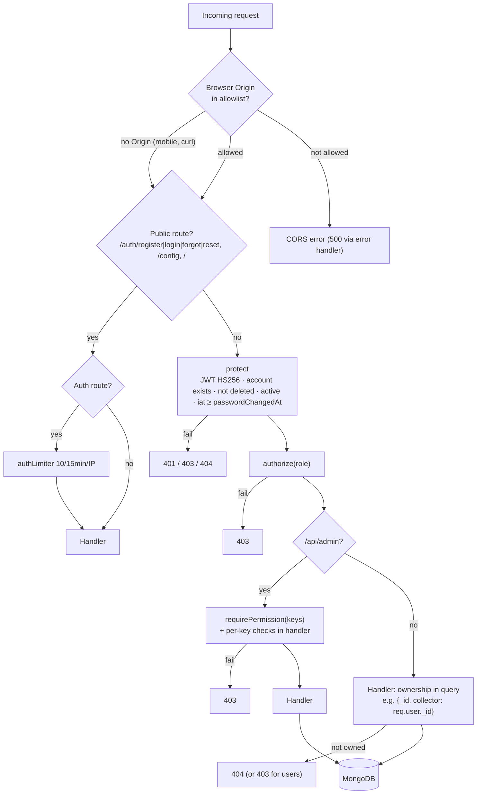

# EcoDash — Security Architecture

Companion to [system-architecture.md](system-architecture.md) §12 and §15. The trust-boundary diagram is in §15.1 of that document. This file holds the detailed assessment. Evidence labels: **[V]** verified in code, **[I]** inferred, **[U]** unknown / needs runtime verification, **[R]** recommended.

> **Scope and method.** This is a static review of the repository at commit `66d077c`. No penetration testing was done, and no production system, Firebase project, Vercel project or database was accessed. Secret values found in the repository are **not reproduced** in this document.

## 1. Attack surface

| Surface | Exposure | Entry points | Notes |
|---|---|---|---|
| REST API | Internet, HTTPS | 98 routes (5 public auth routes, 1 public config route, `GET /`, static `/uploads`) | CORS does not protect non-browser clients. Requests without `Origin` are accepted by design. [V] |
| Firebase RTDB `chats` | Internet, Firebase SDK/REST | `chats/*` | Rules file grants `.read: true`, `.write: true`. The project id and database URL are in the mobile bundle. [V] Deployment of the rules is [U]. |
| Admin portal | Internet, HTTPS | `/login`, `/forgot-password`, admin pages | Edge middleware redirects unauthenticated users; the backend enforces permissions. [V] |
| Mobile binary | Distributed APK/IPA | Inlined Firebase config, Sentry DSN, API URL | These are identifiers rather than secrets (Firebase web config and Sentry DSNs are public by design). Their safety depends on server-side rules. [V] |
| Socket.IO | Only where `server.listen` runs (local, non-Vercel) | `join_room`, `send_message` | No room membership check. [V] Inactive on Vercel. [I] |
| Operator scripts | Shell with `MONGODB_URI` | `seed.js`, `create-admin.js`, `recalculate-performance.js` | `seed.js` wipes collections. [V] |

## 2. Verified security controls

| Control | Where | Evidence |
|---|---|---|
| Password hashing (bcrypt, cost 10) | `pre('save')` on User, Collector, Vendor, Admin | [V] `backend/models/*.js` |
| Password hash excluded from queries by default | `select: false` | [V] |
| JWT algorithm pinned to HS256 on verify | `protect`, `chatHandler` | [V] `backend/middleware/auth.js` |
| Account state checked on every request (exists, not deleted, active) | `protect` | [V] |
| Token invalidation after password reset and account deletion | `passwordChangedAt` vs `iat` | [V] |
| Reset codes: CSPRNG (`crypto.randomInt`), stored as SHA-256, 15 min TTL, ≤5 attempts, timing-safe compare, non-enumerating response, cleared on email failure | `passwordReset` plugin, `authController` | [V] |
| Rate limiting on register, login, forgot and reset | `authLimiter` | [V] `backend/routes/auth.js` |
| Security headers | `helmet()` (with `crossOriginResourcePolicy: false` so media can be embedded) | [V] `backend/server.js` |
| CORS allowlist for browsers | `ALLOWED_ORIGINS` | [V] |
| Body size limits | JSON and urlencoded 50 kB; multer limits | [V] |
| Regex injection prevention in admin search | `escapeRegex` | [V] `adminController` |
| Role separation per router + admin permission checks on every admin route | `authorize`, `requirePermission`, per-key checks | [V] |
| RBAC safety rules | last active Executive, no self role change or deactivation, built-in roles protected | [V] `adminAccessController` |
| Ownership scoping | queries include `collector: req.user._id` / `vendor: req.user._id`; explicit checks for users | [V] |
| Upload type and size restrictions | MIME prefix + field-name filter; Cloudinary `allowed_formats`; profile ≤5 MB; offers ≤100 MB per file, ≤5 images + 1 video | [V] `backend/middleware/upload.js` |
| PII minimisation in monitoring | Sentry `beforeSend` removes `email` and `ip_address` | [V] `frontend/app/_layout.tsx` |
| HTML escaping in status and deletion emails | `escapeHtml` | [V] `backend/utils/email.js` |
| Account deletion anonymises PII and revokes sessions | `accountDeletion.js` | [V] |
| Secrets not committed | `.env*` git-ignored; only `backend/.env.example` (names, no values) is tracked | [V] `git ls-files` |

## 3. Potential vulnerabilities (evidence-backed)

Severity reflects impact assuming the condition holds. "Runtime" marks items whose exploitability depends on deployed configuration.

| ID | Finding | Evidence | Severity | Runtime-dependent? |
|---|---|---|---|---|
| S1 | **Public chat database.** Anyone can read every conversation (which can include phone numbers and addresses exchanged during pickups), write messages with any `senderId`/`senderName`, or overwrite or delete `chats`. | [database.rules.json](../../database.rules.json); [frontend/app/(tabs)/chat.tsx](../../frontend/app/%28tabs%29/chat.tsx) writes client-asserted sender fields | Critical | Yes: are the rules deployed? |
| S2 | **Hard-coded JWT secret fallback** in the portal middleware. The same literal is in tracked documentation. If the backend's `JWT_SECRET` equals it, tokens for **any role** can be forged and the backend would accept them. | [my-app/middleware.ts](../../my-app/middleware.ts), [FEATURES.md](../../FEATURES.md) | High → Critical | Yes: production `JWT_SECRET` |
| S3 | **Self-registered collectors can mint value.** `POST /api/auth/register` accepts `role:'collector'`, and new collectors default to `isVerified: true`. `record-collection` credits points for any `userId`, and an unbounded client-supplied `cashAmount`. | [backend/controllers/authController.js](../../backend/controllers/authController.js) `register`; [backend/models/Collector.js](../../backend/models/Collector.js); `collectorController.verifyDropoff` | High | No |
| S4 | **Race conditions** in points and stock and offer reservation (check-then-act). Concurrent redemptions can overdraw points; concurrent purchases can double-reserve. | `userController.redeemReward`, `vendorController.purchaseWaste` | High | No [I] (not reproduced) |
| S5 | **Business-rule bypass in vendor purchase:** `offerId` is not checked against `collectorId`, and quantity and price are not checked against the offer. A vendor can reserve any collector's offer while attributing the purchase to a different collector. | `vendorController.purchaseWaste` | Medium | No |
| S6 | **Admin token handling:** the JWT is in a JS-readable cookie (no `HttpOnly`, `Secure` or `SameSite` set in code) **and** in `localStorage`. The cookie lasts 24 h but the token lasts 7 days by default. The middleware does not check `role === 'admin'` (backend routes do). | [my-app/app/login/page.tsx](../../my-app/app/login/page.tsx), `middleware.ts` | Medium | Partly (`JWT_EXPIRE`) |
| S7 | **Information disclosure** through `error.message` in 500 responses from controller catches (Mongoose cast and validation messages, internals). | all controllers | Medium | No |
| S8 | **User data lookup by raw id:** `verify-qr` accepts a bare ObjectId or unsigned JSON and returns name, email and phone. QR codes contain only `{userId, type, timestamp}`, so anyone who has seen a QR can replay it. | `collectorController.getUserByQR`, `utils/helpers.generateUserQRCode` | Medium | No |
| S9 | **Password change does not revoke existing tokens**; there is no server-side logout. | `authController.changePassword` | Medium | No |
| S10 | **Credentials by email:** admin-created collectors, vendors and admins receive their password in plain text. `sendWelcomeEmail` interpolates `name` into HTML without escaping. | `backend/utils/email.js` `sendWelcomeEmail`; `adminController.createCollector/createVendor`; `adminAccessController.createAdmin` | Medium | No |
| S11 | **Weak password policy:** length ≥ 6 only. There is no lockout per account; only the per-IP limit, which is per serverless instance. | models, `routes/auth.js` | Medium | Partly |
| S12 | **Cross-role email reuse:** `register` doesn't check `admins`. Admin-created collectors and vendors are only checked within their own collection. | `register`, `createCollector`, `createVendor` | Low | No |
| S13 | **Socket.IO room join without authorisation** (dormant code). | `backend/socket/chatHandler.js` | Low (dormant) | Yes: only where not serverless |
| S14 | **Mass-assignment surface:** `updateOffer`, `updateReward`, `updateChallenge` and similar handlers were not fully reviewed for field whitelisting. | collector, vendor and admin controllers | [U] | — |
| S15 | **Destructive seed** with known demo passwords if run against production. | [backend/seed.js](../../backend/seed.js) | Medium (operational) | Yes |
| S16 | **Verbose logs** of request data (`console.log` of payment and request bodies) in some handlers. | `completeUserWastePickup`, `getNearbyCollectors` | Low | — |

**Not found:** SQL injection (no SQL). NoSQL operator injection through `req.body` into `findOne({email})` is [U]: Express parses JSON objects, so `{"email": {"$ne": null}}` would reach `Model.findOne({ email })`. Mongoose's `sanitizeFilter` is not enabled, and no sanitiser middleware is installed. [V] Because `login` still requires a bcrypt match against the *first* matched account, practical impact is limited to **enumeration and timing**. Treat this as a hardening item (S17 below). XSS in the portal: React escapes by default, and `my-app/app` and `my-app/components` contain no `dangerouslySetInnerHTML` [V].

| ID | Finding | Evidence | Severity |
|---|---|---|---|
| S17 | No NoSQL operator sanitisation (`sanitizeFilter`, `express-mongo-sanitize`, or type checks on `email`/`code`) | `authController.login/forgotPassword/resetPassword` (`forgot` and `reset` coerce with `String()`; `login` does not) | Low–Medium |

## 4. Authorisation enforcement points

**What it shows:** the order of the checks for each request class, and where each check lives.

## 5. Data protection

| Data | At rest | In transit | Notes |
|---|---|---|---|
| Passwords | bcrypt hash | HTTPS [I] (Vercel default) | — |
| Reset codes | SHA-256 hash | email (SMTP STARTTLS on 587, `secure:false` + upgrade) [I] | 6 digits, 5 attempts |
| JWTs | Mobile: AsyncStorage (unencrypted). Portal: cookie + localStorage. | HTTPS | No refresh tokens |
| PII (name, email, phone, address, location) | MongoDB (encryption at rest depends on the host [U]) | HTTPS | Exposed to counterparties via populated responses (e.g. `browseUserOffers` returns the user's email, phone and address to every collector) [V] |
| Chat messages | Firebase RTDB | HTTPS/WSS | Publicly readable per the rules file |
| Media | Cloudinary public URLs | HTTPS | URLs are unguessable but public; no signed delivery [V] |
| Crash data | Sentry | HTTPS | email and IP scrubbed |

## 6. Secret management

| Secret | Source | Committed? |
|---|---|---|
| `JWT_SECRET` (backend and portal must match) | env | No. **A fallback literal is committed in the portal middleware and FEATURES.md.** |
| `MONGODB_URI`, `CLOUDINARY_URL`, `EMAIL_USER`/`EMAIL_PASS` | env | No (`.env` ignored) [V] |
| `NEXT_PUBLIC_GOOGLE_MAPS_API_KEY` | env (shipped to the browser by design) | No [V] |
| Firebase web config, Sentry DSN, EAS project id | inlined in source | Yes. These are identifiers, not secrets, but S1 makes the Firebase config effectively a credential. |
| Sentry auth token for source maps | `frontend/{android,ios}/sentry.properties` (local, generated) | No. The native folders are git-ignored [V]. Contents were not inspected. |

## 7. Items requiring runtime verification
1. Deployed RTDB rules for project `ecodash-27845` (S1).
2. Production `JWT_SECRET` on the backend and on the portal (S2); `JWT_EXPIRE`.
3. Vercel: HTTPS-only, environment variables per project, function logs retention.
4. MongoDB: network access list, TLS, user privileges, backups, encryption at rest.
5. Cloudinary: unsigned upload presets disabled, delivery restrictions.
6. Google Maps API key HTTP-referrer restrictions.
7. Dependency vulnerabilities: run `npm audit` (backend, frontend) and `pnpm audit` (my-app). **Not run in this review.**
8. Where Sentry upload credentials are kept for EAS builds (the local `sentry.properties` files are not in git).

## 8. Recommended remediation order [R]
1. **S1:** Firebase Auth custom tokens issued by the API, and rules restricting `chats/$roomId` to participants with `newData.child('senderId').val() === auth.uid`.
2. **S2:** delete the fallback (fail closed when `JWT_SECRET` is missing), remove the literal from FEATURES.md, and rotate the secret if it was ever used.
3. **S3/S5:** require admin verification for self-registered collectors and vendors before value-moving routes; compute cash server-side; cap and validate purchases against the offer.
4. **S4:** atomic conditional updates (`findOneAndUpdate({_id, points: {$gte: n}}, {$inc: {points: -n}})`) and transactions.
5. **S6, S9, S11:** HttpOnly session cookie set by a Next.js route handler; set `passwordChangedAt` on change; stronger password policy; per-account login throttling with a shared store.
6. **S7, S10, S16, S17:** generic production errors; set-password links instead of emailed passwords; structured logs without payloads; enable `mongoose.set('sanitizeFilter', true)` or validate types.
