# EcoDash — System Architecture Document

| | |
|---|---|
| **Document** | EcoDash (MyEcoDash) System Architecture Document (SAD) |
| **Version** | 1.0 |
| **Prepared** | 2026-10-21 |
| **Code baseline** | branch `work-branch-avishka`, commit `66d077c` |
| **Scope** | All three apps in this repository: `backend/` (REST API), `frontend/` (mobile app), `my-app/` (admin portal), plus Firebase configuration at the repo root |
| **Companion documents** | [README](README.md) · [Data flow](data-flow.md) · [Database](database.md) · [API](api-architecture.md) · [Security](security-architecture.md) · [Deployment](deployment-architecture.md) |

---

## 1. Document Overview

### 1.1 Purpose and audience
This document describes how EcoDash is **actually built** at the code baseline above: its components, data flows, persistence, security controls, deployment and known weaknesses. It is written for:

- **developers** joining the project or extending a feature,
- **technical leads** planning work and judging trade-offs,
- **security reviewers** assessing the attack surface,
- **maintainers** troubleshooting production behaviour.

It is not a requirements specification. For intended behaviour see [SRS_EcoDash.md](../../SRS_EcoDash.md), and for a per-screen walkthrough see [FEATURES.md](../../FEATURES.md). Where those documents disagree with the code, this document follows the code and records the difference (§23.3).

### 1.2 How claims are labelled
Every significant statement carries one of these evidence labels:

| Label | Meaning |
|---|---|
| **[V] Verified** | Read directly in source code or configuration at the baseline commit. A file reference is given. |
| **[I] Inferred** | Strongly suggested by the implementation, but not proven (e.g. runtime behaviour on Vercel). |
| **[U] Unknown** | Cannot be established from the repository (e.g. cloud project settings). |
| **[R] Recommended** | A proposed improvement. **Not** an existing capability. |

Nothing in this document was verified against the running production system. Runtime connectivity, deployed Firebase rules, and cloud settings were **not tested**. The only things executed were the frontend Jest suite (§17) and Mermaid rendering of the diagrams (§23.5).

### 1.3 System overview (one paragraph)
EcoDash is a recycling marketplace for Sri Lanka with three participant roles: **users** (households), **collectors** and **vendors** (recyclers), plus an internal **admin** team. Users and collectors run an Expo/React Native app. Admins use a Next.js web portal. Both clients call one Express 5 REST API that persists to MongoDB through Mongoose. Uploaded media goes to Cloudinary, email goes out over SMTP via nodemailer, and in-app chat runs directly between the mobile app and Firebase Realtime Database without passing through the API. Mobile crashes are reported to Sentry.

### 1.4 Definitions and abbreviations

| Term | Meaning in this codebase |
|---|---|
| **User** | A household account (`User` model, route group `(tabs)`). Note: also used generically for "account". |
| **Collector** | Waste-collection business (`Collector` model, route group `(collector-tabs)`) |
| **Vendor** | Recycler or buyer of sorted waste (`Vendor` model, route group `(vendor-tabs)`) |
| **Admin** | Portal operator (`Admin` model) whose permissions come from an `AdminRole` |
| **UserWasteOffer** | Waste a user lists for collectors to buy |
| **CollectorPurchaseRequest** | A collector's bid on a `UserWasteOffer` (chat room prefix `req_`) |
| **WasteOffer** | Sorted waste a collector lists for vendors |
| **WastePurchase** | A vendor's purchase request against a collector (chat room prefix `pur_`) |
| **WasteTransaction** | A QR-verified drop-off at a collector, awarding points or cash |
| **AppConfig** | Key/value runtime configuration edited from the portal |
| **Envelope** | The `{ success, data?, message? }` JSON shape all API responses use |
| SAD / DFD / ERD | System Architecture Document / Data Flow Diagram / Entity-Relationship Diagram |
| RTDB | Firebase Realtime Database |
| RBAC | Role-based access control |
| EAS | Expo Application Services (cloud build) |
| LKR | Sri Lankan rupee, the currency in user-facing cash messages |

---

## 2. System Overview

### 2.1 Business purpose
The platform gives households a buyer for recyclables, gives collectors a steady supply with records, gives vendors sorted material, and rewards recycling with points, cash and vendor-funded rewards. See [docs/EcoDash-Overview.md](../EcoDash-Overview.md) for the business narrative.

### 2.2 Actors

| Actor | Client | Authenticates as | Evidence |
|---|---|---|---|
| Household user | Mobile app | `role: 'user'` | [V] [backend/routes/users.js](../../backend/routes/users.js) `authorize('user')` |
| Collector | Mobile app | `role: 'collector'` | [V] [backend/routes/collectors.js](../../backend/routes/collectors.js) |
| Vendor | Mobile app | `role: 'vendor'` | [V] [backend/routes/vendors.js](../../backend/routes/vendors.js) |
| Admin (Executive / Manager / Admin / custom roles) | Admin portal | `role: 'admin'` plus `AdminRole` permissions | [V] [backend/routes/admin.js](../../backend/routes/admin.js), [backend/config/adminPermissions.js](../../backend/config/adminPermissions.js) |
| Operator with shell and DB access | CLI scripts | `MONGODB_URI` | [V] [backend/seed.js](../../backend/seed.js), [backend/create-admin.js](../../backend/create-admin.js), [backend/recalculate-performance.js](../../backend/recalculate-performance.js) |

`superadmin` is accepted by `protect`/`authorize`, but `login` only ever issues `role: 'admin'` tokens to admins. [V] [backend/controllers/authController.js](../../backend/controllers/authController.js) `login`.

### 2.3 Core capabilities

| Capability | Roles | Main code |
|---|---|---|
| Registration, login, profile, profile photo, change and reset password | all | `authController` |
| User → collector marketplace (offers, bids, accept/reject, pickup, payment) | user, collector | `userController`, `collectorController` |
| QR drop-off with points or cash reward | collector (scans a user) | `collectorController.getUserByQR`, `verifyDropoff` |
| Collector → vendor marketplace (offers, purchase requests, counter-offers, completion) | collector, vendor | `collectorController`, `vendorController` |
| Rewards catalogue and redemption codes | vendor creates, user redeems, vendor verifies | `vendorController`, `userController.redeemReward` |
| Challenges, badges, leaderboard | user (admin creates challenges and badges) | `userController`, `adminController` |
| Ratings (user → collector, collector → vendor) and collector performance score | user, collector | `rateCollector`, `rateVendor`, [backend/utils/collectorPerformance.js](../../backend/utils/collectorPerformance.js) |
| 1:1 chat per deal | user↔collector, collector↔vendor | Firebase RTDB from the mobile chat screens |
| Admin: accounts, RBAC, configuration, help content, transactions, dashboard | admin | `adminController`, `adminAccessController`, `services/*` |
| Localisation (English, Sinhala, Tamil) | mobile | [frontend/context/LanguageContext.tsx](../../frontend/context/LanguageContext.tsx), [frontend/locales/](../../frontend/locales/) |

### 2.4 System boundary and external dependencies
Inside the boundary: the three apps in this repo. Outside it: MongoDB (Atlas per CLAUDE.md; the host is [U] from code), Cloudinary, an SMTP server (defaults to `smtp.gmail.com`), Firebase RTDB, Sentry, Google Maps (portal map picker and, [I], the mobile map), Vercel (hosting), Expo/EAS (builds), and the device platform services for camera and location.

### 2.5 Key architectural characteristics
- **Three independently built and deployed apps.** There is no monorepo tooling or root `package.json`. [V]
- **A single API service.** One Express app holds every domain area. On Vercel it runs as one serverless function. [V] [backend/api/index.js](../../backend/api/index.js), [backend/vercel.json](../../backend/vercel.json)
- **Thin routes, fat controllers.** Business rules live in controllers of 300–1340 lines, with a few extracted services. [V]
- **One collection per role.** The role travels in the JWT, not on the account record. [V]
- **Chat bypasses the API entirely.** It goes client ↔ Firebase. [V]
- **No transactions, queues, caches or scheduled jobs.** All work is synchronous inside the HTTP request. [V] (repository-wide search found no `startSession`, queue or cron libraries.)

---

## 3. Architecture Principles and Design

### 3.1 Architectural style
**Client–server with a modular monolith backend.** The evidence is a single Express application mounting seven routers, with no service-to-service calls ([backend/server.js](../../backend/server.js)). [V] The backend is *deployed* as a serverless function on Vercel. [V/I] `vercel.json` rewrites all paths to `/api`, and `api/index.js` exports the app. That changes runtime behaviour (§18) but not the code's structure. It is not a microservices system.

### 3.2 Layering (backend)

```
HTTP ─► server.js (helmet, CORS, body limits, static /uploads, error handler)
     ─► routes/*.js        (path → middleware chain → handler; no logic)
     ─► middleware/        (auth.protect · authorize · requirePermission · upload)
     ─► controllers/*.js   (validation, business rules, persistence, response)
     ─► services/*.js, utils/*.js  (shared logic: access, deletion, email, scoring, QR)
     ─► models/*.js        (Mongoose schemas, hooks, password hashing)
     ─► MongoDB · Cloudinary · SMTP
```

Layer rules are **conventions, not enforced**. Two examples: `routes/chat.js` and `routes/config.js` contain their handler logic inline, and controllers call models directly with no repository layer. [V]

### 3.3 Separation of concerns: notable decisions [V]
- Response envelope `{ success, data?, message? }` everywhere. Most controllers wrap their body in `try/catch` and return `500` with `error.message`.
- Shared rules extracted into services: [backend/services/profileUpdate.js](../../backend/services/profileUpdate.js) (validated partial profile updates), [backend/services/accountDeletion.js](../../backend/services/accountDeletion.js), [backend/services/adminAccess.js](../../backend/services/adminAccess.js), [backend/services/adminTransactions.js](../../backend/services/adminTransactions.js).
- The admin permission catalog is a single source of truth: [backend/config/adminPermissions.js](../../backend/config/adminPermissions.js).
- Mobile: `ENDPOINTS` map, an axios instance, three React contexts (Auth, AppConfig, Language), and file-based routing with one route group per role.

### 3.4 Communication patterns

| Path | Pattern | Protocol | Evidence |
|---|---|---|---|
| Mobile → API | Synchronous request/response | HTTPS JSON (axios, 10 s timeout). Multipart for media. Some screens use `fetch` directly. | [V] [frontend/services/api.ts](../../frontend/services/api.ts), [frontend/__tests__/setup/apiMock.ts](../../frontend/__tests__/setup/apiMock.ts) |
| Portal → API | Synchronous, browser `fetch` with bearer token | HTTPS JSON (cross-origin, CORS) | [V] [my-app/lib/api.ts](../../my-app/lib/api.ts) |
| Mobile ↔ Firebase RTDB | Asynchronous push/subscribe (`push`, `onValue`) | Firebase SDK (WebSocket/HTTPS) | [V] [frontend/app/(tabs)/chat.tsx](../../frontend/app/%28tabs%29/chat.tsx) |
| API → Cloudinary | Synchronous upload streamed during request parsing | HTTPS (SDK) | [V] [backend/middleware/upload.js](../../backend/middleware/upload.js) |
| API → SMTP | Synchronous (awaited) or fire-and-forget | SMTP/STARTTLS on 587 by default | [V] [backend/utils/email.js](../../backend/utils/email.js) |
| API ↔ Socket.IO clients | Event-based | WebSocket | [V] wired in `server.js`; [I] not functional on Vercel; [V] no client imports `socketService` |
| Mobile → Sentry | Asynchronous error/trace upload | HTTPS | [V] [frontend/app/_layout.tsx](../../frontend/app/_layout.tsx) |

### 3.5 Important decisions and implications
Covered in detail in §20. In brief: role-per-collection, a JWT that carries the role, client-direct Firebase chat, serverless hosting, derived (not stored) inventory, runtime config in MongoDB, and soft deletion with anonymisation.

---

## 4. Technology Stack

Versions are **resolved lockfile versions** (`package-lock.json` / `pnpm-lock.yaml`). Node runtime on Vercel is [U]. Local Node was v22.20.0.

| Layer | Technology | Version | Purpose | Where used | Evidence |
|---|---|---|---|---|---|
| Backend runtime | Node.js + Express | 5.1.0 | HTTP API | `backend/` | [V] [backend/package.json](../../backend/package.json) |
| ODM / DB access | Mongoose | 8.19.3 | Schemas, validation, queries | `backend/models` | [V] |
| Database | MongoDB | [U] server version | Primary persistence | `MONGODB_URI` | [V] [backend/config/db.js](../../backend/config/db.js); Atlas per CLAUDE.md [I] |
| Auth | jsonwebtoken / bcryptjs | 9.0.2 / 3.0.3 | HS256 JWTs, password hashing (cost 10) | `config/jwt.js`, models | [V] |
| Security middleware | helmet, cors, express-rate-limit | 8.2.0 / 2.8.5 / 8.5.2 | Headers, origin allowlist, auth rate limiting | `server.js`, `routes/auth.js` | [V] |
| Uploads | multer + multer-storage-cloudinary + cloudinary | 2.0.2 / 4.0.0 / 1.41.3 | Streaming uploads to Cloudinary | `middleware/upload.js` | [V] |
| Email | nodemailer | 8.0.10 | Welcome, reset, status, deletion emails | `utils/email.js` | [V] |
| QR | qrcode | 1.5.4 | QR PNG data URLs for users and redemptions | `utils/helpers.js` | [V] |
| Realtime (legacy) | socket.io | 4.8.3 | Chat over WebSocket (inactive path) | `socket/chatHandler.js` | [V] wired; [I] unused |
| Declared but unused | express-validator | 7.3.0 | — | none | [V] no import found |
| Mobile framework | Expo SDK / React Native / React | 54.0.22 / 0.81.5 / 19.1.0 | Cross-platform app (New Architecture, Hermes) | `frontend/` | [V] [frontend/app.json](../../frontend/app.json) |
| Mobile routing | expo-router | 6.0.14 | File-based routes, typed routes | `frontend/app` | [V] |
| Mobile HTTP | axios | 1.13.2 | API client | `services/api.ts` | [V] |
| Mobile chat | firebase (JS SDK) | 12.13.0 | RTDB chat | `services/firebase.ts` | [V] |
| Mobile maps / device | react-native-maps, expo-location, expo-camera, expo-image-picker | 1.20.1 / ~19 / ~17 / ~17 | Map, location, QR scanning, photos | screens | [V] |
| Mobile monitoring | @sentry/react-native | 7.2.0 | Crash and error reporting, 20 % trace sampling | `app/_layout.tsx` | [V] |
| Admin portal | Next.js / React | 16.2.6 / 19.2.4 | Admin web app (App Router, client components) | `my-app/` | [V] |
| Portal styling | Tailwind CSS | 4.3.0 | Styling | `my-app/` | [V] |
| Portal auth check | jose | 6.2.3 | Edge JWT verification in middleware | `my-app/middleware.ts` | [V] |
| Portal maps | @react-google-maps/api | ^2.20.8 | Collector location picker | `(admin)/collectors/page.tsx` | [V] |
| Testing | Jest + jest-expo + @testing-library/react-native | 29.7.0 / 54.0.18 / 13.3.3 | Mobile unit, component and flow tests | `frontend/__tests__` | [V] |
| Lint / types | ESLint 9, TypeScript | 5.9.3 | Static checks (mobile and portal) | | [V] |
| Hosting | Vercel | — | Backend serverless function. Portal [I] (CORS origin `*.vercel.app`) | `backend/vercel.json` | [V]/[I] |
| Mobile builds | EAS Build, local Gradle and Xcode | — | APK/IPA builds | [frontend/eas.json](../../frontend/eas.json), [frontend/build-release.sh](../../frontend/build-release.sh) | [V] |
| CI/CD | — | — | **None found** | no `.github/workflows` | [V] |

---

## 5. High-Level System Architecture

### 5.1 System context diagram

**What it shows:** EcoDash as a whole, the people who use it, and the external systems it depends on.

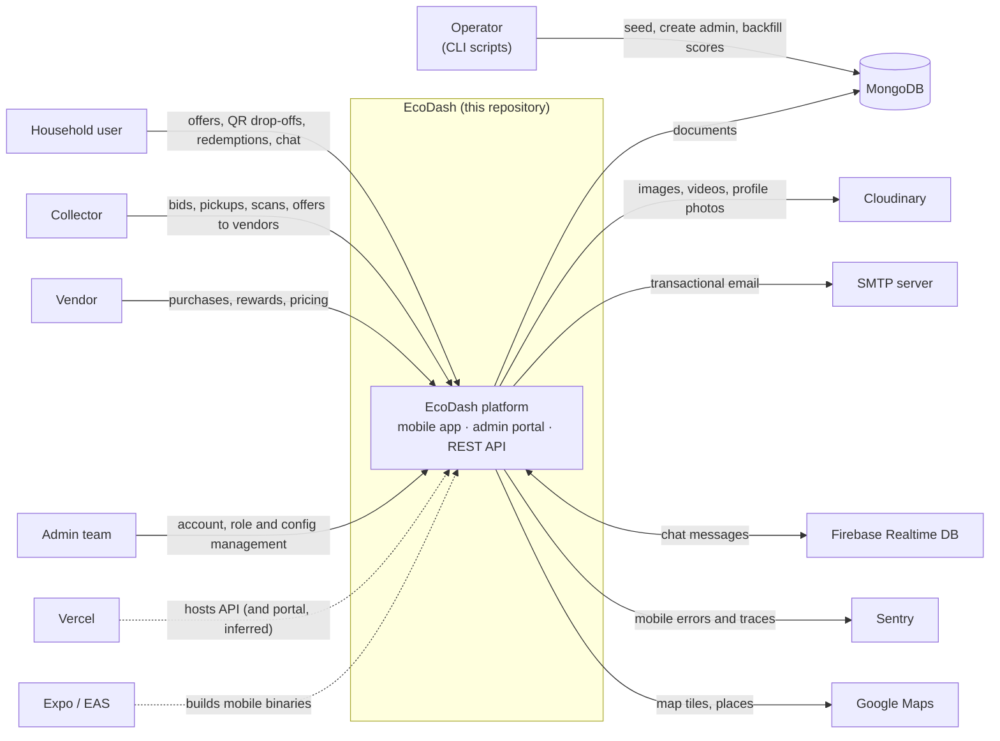

### 5.2 High-level architecture diagram

**What it shows:** the runtime containers, how they talk, and the trust boundaries (dashed subgraphs).

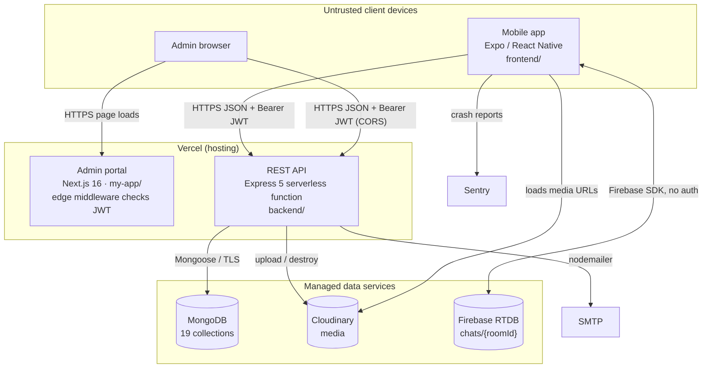

### 5.3 Component responsibilities and interfaces

| Component | Responsibility | Interface offered | Trust level |
|---|---|---|---|
| Mobile app | UI for user, collector and vendor. Stores JWT in AsyncStorage. Chat. | none (client) | Untrusted |
| Admin portal | UI for admins. Edge redirect for missing or invalid cookie. Hides UI by permission. | Web pages | Untrusted for authorisation: the backend enforces every permission [V] |
| REST API | Authentication, authorisation, all business rules, persistence, media and email | `/api/*` JSON (§10) | Trusted |
| MongoDB | System of record | MongoDB wire protocol | Trusted |
| Cloudinary | Media storage and transformation | Cloudinary REST via SDK | External, trusted by URL |
| Firebase RTDB | Chat store and fan-out | Firebase SDK | External. **Rules allow public read/write** (§15) |
| SMTP | Outbound email | SMTP | External |

---

## 6. Component and Module Architecture

### 6.1 Component diagram (backend)

**What it shows:** the backend's internal components and what each one calls.

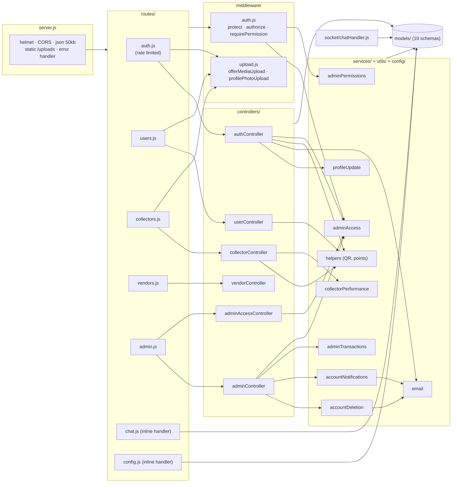

### 6.2 Component catalogue

| Component | Purpose | Inputs → outputs | Depends on | Data owned (writes) | Error handling |
|---|---|---|---|---|---|
| `authController` | Register, login, me, profile, password change and reset, profile photo | JSON or multipart → envelope + JWT | models, `config/jwt`, `helpers`, `email`, `adminAccess`, `profileUpdate`, `upload` | User, Collector, Vendor, Admin (profile and credential fields) | try/catch → 400/401/403/500. Reset and change errors deliberately use 400, not 401 (the client signs out on 401). |
| `userController` | User dashboard, rewards, redemptions, challenges, leaderboard, badges, offers, answering bids, rating collectors | → envelope | models, `helpers` | UserWasteOffer, RewardRedemption, Rating; User.points; Challenge.participants | try/catch → 500 `error.message` |
| `collectorController` | Dashboard, QR lookup, drop-off recording, reports, inventory, offers to vendors, answering vendor requests, bidding on user offers, pickup completion, rating vendors | → envelope | models, `helpers`, `collectorPerformance`, `upload` | WasteTransaction, WasteOffer, CollectorPurchaseRequest; WastePurchase status; User points and cash; Collector totals | try/catch → 500. `refreshPerformanceSafely` swallows scoring errors. |
| `vendorController` | Dashboard, rewards CRUD, redemption verification, analytics, browsing offers, purchasing, inventory, pricing | → envelope | models | Reward, WastePurchase, VendorPricing, RewardRedemption.status | try/catch → 500 |
| `adminController` | Dashboard, account management, challenges and badges, analytics, AppConfig, transactions | → envelope | models, `email`, `accountNotifications`, `accountDeletion`, `adminTransactions`, `adminAccess` | Accounts, Challenge, Badge, AppConfig | try/catch. `listTransactions` throws `error.status = 400`. |
| `adminAccessController` | My access, roles CRUD, admin accounts | → envelope | `adminAccess`, `email`, models | AdminRole, Admin | Guards: last-Executive rule, no self-demotion or self-deactivation, built-in roles immutable |
| `middleware/auth.js` | Authentication and authorisation | `Authorization: Bearer` → `req.user`, `req.userRole`, `req.adminAccess` | models, `adminAccess` | none (except the admin role migration in `resolveAdminAccess`) | 401/403/404 JSON |
| `middleware/upload.js` | Cloudinary uploads and profile photo cleanup | multipart → `req.files` / `req.file.path` (Cloudinary URL) | cloudinary | Cloudinary assets | Offer media errors go to Express's error handler. Profile photo errors map to 400/502. |
| `services/adminAccess.js` | Seeds built-in roles once per process, resolves permissions, migrates role-less admins to Executive | Admin doc → `{ role, permissions }` | AdminRole, Admin | AdminRole (upsert), Admin.adminRole | Memoised promise reset on failure |
| `services/accountDeletion.js` | Soft-deletes and anonymises an account, cancels its open deals, emails the owner | role + id → result | models, `email` | Many collections (`updateMany`) | Email failure logged, not fatal |
| `utils/collectorPerformance.js` | 0–100 score from frequency, completion, responsiveness, volume | collectorId → `Collector.performance` | models | Collector.performance | `refreshPerformanceSafely` never throws |
| `socket/chatHandler.js` | Legacy Socket.IO chat | JWT handshake → `new_message` | ChatMessage, accounts | ChatMessage | Emits `message_error` |
| Mobile `services/api.ts` | HTTP client | → `response.data` envelope | AsyncStorage | Clears auth on any 401 | Rejects with the server envelope or a message string |
| Mobile contexts | `AuthContext` (session), `AppConfigContext` (`/config`, falls back to constants), `LanguageContext` (en/si/ta) | | api, AsyncStorage | Local session and language | Config fetch failure keeps the defaults silently |
| Portal `lib/api.ts`, `lib/access.tsx` | `apiFetch` with cookie token. `useAccess().can()` for UI gating. | | `/admin/me` | none | Pages handle `{ success:false }` |

### 6.3 Module dependency diagram (cross-app)

**What it shows:** source-level dependencies across the three apps and the files they share by convention (not by import).

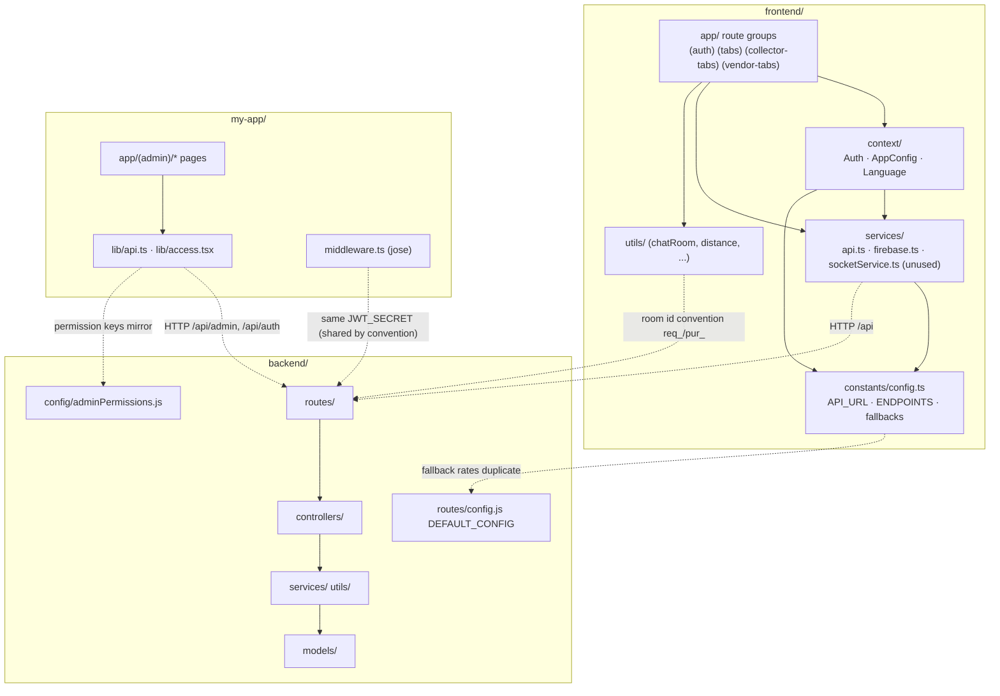

---

## 7. Data Flow Architecture

### 7.1 External entities, processes and stores
The DFD identifiers below are used consistently in this document and in [data-flow.md](data-flow.md).

| ID | Kind | Name |
|---|---|---|
| E1–E4 | External entity | User, Collector, Vendor, Admin |
| E5 | External entity | Cloudinary |
| E6 | External entity | SMTP mail server |
| E7 | External entity | Firebase RTDB (treated as external, because clients use it directly) |
| P1 | Process | Authenticate and manage identity |
| P2 | Process | User → collector marketplace |
| P3 | Process | QR drop-off and rewards accrual |
| P4 | Process | Collector → vendor marketplace |
| P5 | Process | Rewards, redemptions, challenges, ratings |
| P6 | Process | Administration (accounts, RBAC, config, reports) |
| P7 | Process | Chat (client-side, via E7) |
| D1 | Store | Accounts: `users`, `collectors`, `vendors`, `admins` |
| D2 | Store | Access control: `adminroles` |
| D3 | Store | User marketplace: `userwasteoffers`, `collectorpurchaserequests` |
| D4 | Store | Vendor marketplace: `wasteoffers`, `wastepurchases` |
| D5 | Store | Drop-offs: `wastetransactions` |
| D6 | Store | Engagement: `rewards`, `rewardredemptions`, `challenges`, `badges`, `ratings` |
| D7 | Store | Configuration: `appconfigs` (+ `vendorpricings`) |
| D8 | Store | Media (Cloudinary assets). Held by E5, so DFDs draw media flows to E5. |
| D9 | Store | Chat (`chats/{roomId}` in RTDB, held by E7 and drawn as E7; legacy `chatmessages` in MongoDB) |

### 7.2 Validation and authorisation points [V]
1. **Transport:** CORS allowlist for browser origins. Requests with no `Origin` header (mobile, curl) are always allowed.
2. **Body limits:** JSON and urlencoded bodies capped at 50 kB. Multipart size limited by multer (offer media 100 MB per file, profile photos 5 MB).
3. **Rate limit:** 10 requests per 15 minutes per IP on register, login, forgot-password and reset-password.
4. **Authentication:** `protect` checks the HS256 signature and expiry, then that the account exists, is not deleted, is active, and the token is newer than `passwordChangedAt`.
5. **Role:** `authorize(...)` on each router.
6. **Admin permission:** `requirePermission(key)` per admin route, plus per-key checks inside handlers (`updateAppConfig`, `denyStatusChange`).
7. **Ownership:** checked inside controllers by including `collector: req.user._id` / `vendor: req.user._id` in queries, or by explicit `user` comparison (`respondToPurchaseRequest`, `deleteWasteOffer`).
8. **Field validation:** Mongoose schema validation on `create`/`save`, and ad-hoc checks in controllers. There is no request-schema library. `express-validator` is installed but unused.

**Not validated server-side (selected):** the drop-off `cashAmount` (client-computed), vendor `pricePerUnit` and `quantity` against the referenced offer, and that `offerId` belongs to `collectorId` in `purchaseWaste`. Details in §15 and §21.

### 7.3 Major flow traces (summary)
Detailed Level-2 decompositions are in [data-flow.md](data-flow.md). In summary:

| Flow | Input | Transformations | Stores written | External calls | Output |
|---|---|---|---|---|---|
| Login | email, password, role | collection chosen by role, bcrypt compare, sign `{id, role}` | — (admins: may write `adminRole`, upsert `adminroles`) | — | JWT + profile subset |
| Password reset | email, role → later code + new password | 6-digit code, SHA-256 hash stored, 15 min TTL, max 5 attempts, timing-safe compare | D1 reset fields, `passwordChangedAt` | SMTP | generic success message |
| User offer | form + up to 5 images and 1 video | quantity and location parsed (JSON strings in multipart) | D3, D8 | Cloudinary | offer document |
| Collector bid → accept → pickup | price, pickup time → status → payment | status machine, payment default, points = floor(kg × 10) | D3, D1 (User cash and points, Collector totals) | — | completed request |
| QR drop-off | QR text → user, then type, weight, reward type | points from hard-coded table, cash from client | D5, D1 (User, Collector), Badge awards | — | transaction + new badges |
| Vendor purchase | offer, price, quantity | offer reserved → sold or available | D4 | — | purchase |
| Redemption | rewardId | points check, random 8-hex code, QR data URL | D6, D1 | — | code + QR |
| Account deletion | admin, id, reason | cancel open items, anonymise, invalidate tokens | D1, D3, D4, D6 | SMTP | name and email of the deleted account |
| Chat | message text | none (client writes raw) | D9 (RTDB) | Firebase | live message list |

---

## 8. Data Flow Diagrams

**Notation (all DFDs):** `[ Rectangle ]` = external entity (E*). `(( Circle ))` = process (P*). `[( Cylinder )]` = data store (D*). Arrows are labelled with the **data** that moves. A dashed subgraph is a trust boundary.

### 8.1 DFD Level 0 — Context diagram

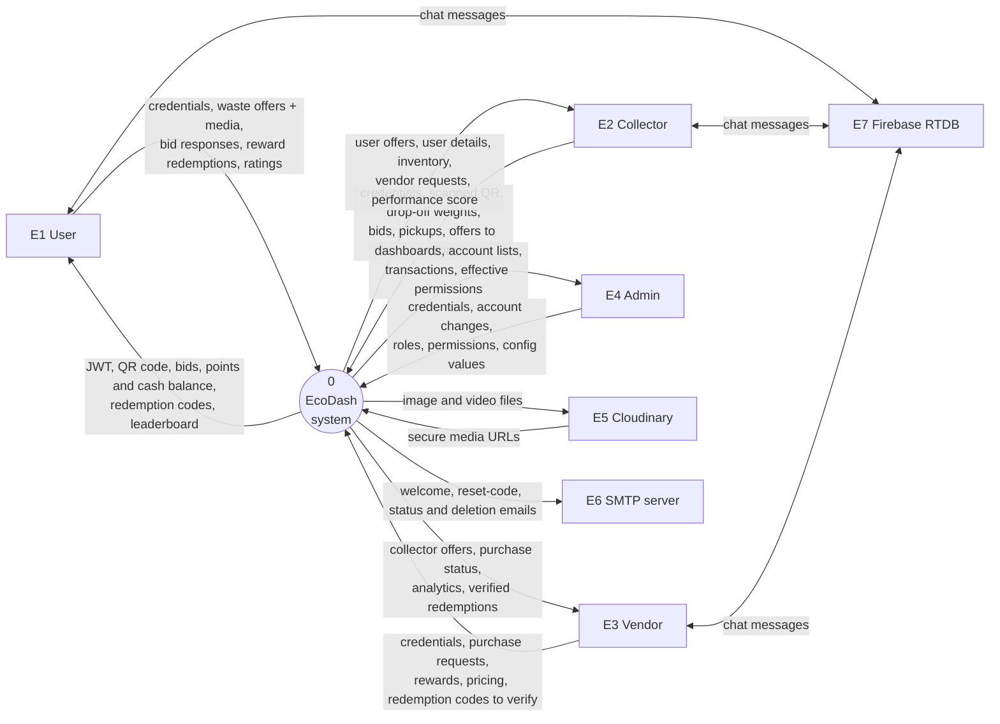

Chat flows go straight between the clients and **E7** without passing through the EcoDash backend. That is why E7 sits outside P0.

### 8.2 DFD Level 1 — System decomposition

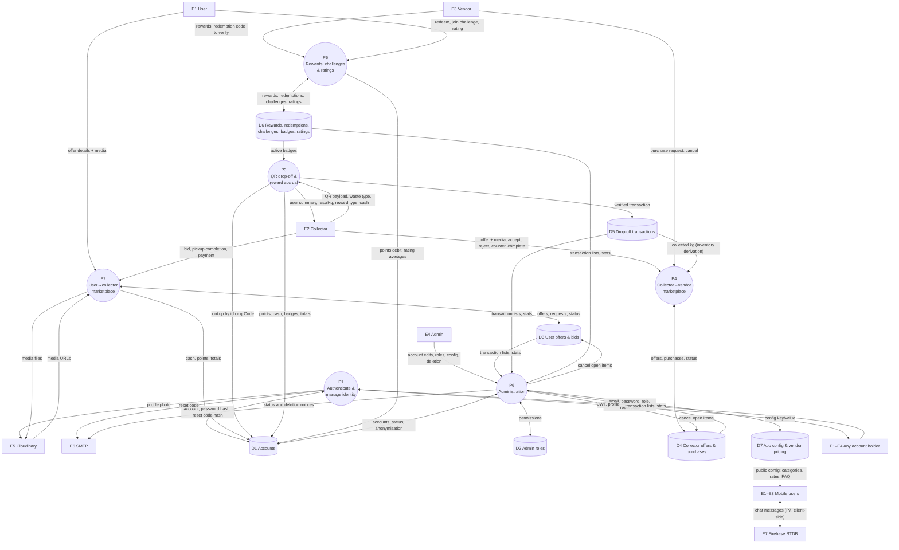

### 8.3 DFD Level 2 — index
Six Level-2 diagrams are in [data-flow.md](data-flow.md):

| Diagram | Decomposes | Why it warrants one |
|---|---|---|
| 2-A Authentication & password reset | P1 | security-critical, multi-step, crosses into SMTP |
| 2-B User → collector deal lifecycle | P2 | five-state machine across two roles and three collections |
| 2-C QR drop-off | P3 | money and points minting |
| 2-D Collector → vendor purchase | P4 | reservation and counter-offer states |
| 2-E Reward redemption | P5 | points debit, code issuance and verification |
| 2-F Admin account deletion with RBAC | P6 | permission enforcement, cascading cancellation, anonymisation |

---

## 9. Application Request Lifecycle

### 9.1 Steps, as implemented
1. **User action:** for example, a collector taps "Accept" in the mobile app.
2. **Frontend validation:** screen-level checks such as `Number.isFinite` on weight in [frontend/app/(collector-tabs)/scan.tsx](../../frontend/app/%28collector-tabs%29/scan.tsx). There is no shared form-validation library. [V]
3. **Request construction:** `api.post(ENDPOINTS.X, body)`. The request interceptor reads `@waste_app_token` from AsyncStorage and adds `Authorization: Bearer`. Timeout 10 s. [V] In the portal, `apiFetch` reads the `ecodash_admin_token` cookie. [V]
4. **Edge (Vercel):** `vercel.json` rewrites every path to the `/api` function, which loads `server.js`. A cold start runs `connectDB()` and the module-level setup. [V/I]
5. **Global middleware:** helmet → CORS (origin allowlist or no Origin) → JSON parser (50 kB) → router. [V]
6. **Router-level middleware:** `protect` (JWT + account checks) → `authorize(role)` → for admin routes `requirePermission(key)` → for media routes the multer/Cloudinary upload. [V]
7. **Controller:** validates input, runs ownership-scoped queries, mutates documents with sequential `save()`/`updateMany`, and calls `refreshPerformanceSafely` or email where relevant. [V]
8. **Response:** `res.status(n).json({ success, data, message })`. Unhandled errors reach the global handler, which hides the message in production. Most controller `catch` blocks return `error.message` regardless of environment. [V]
9. **Client update:** the axios response interceptor returns `response.data`. On a 401 it clears the stored token, user and role. Screens update local state and show `Alert`s. [V]

### 9.2 Sequence: successful request (collector accepts a vendor purchase)

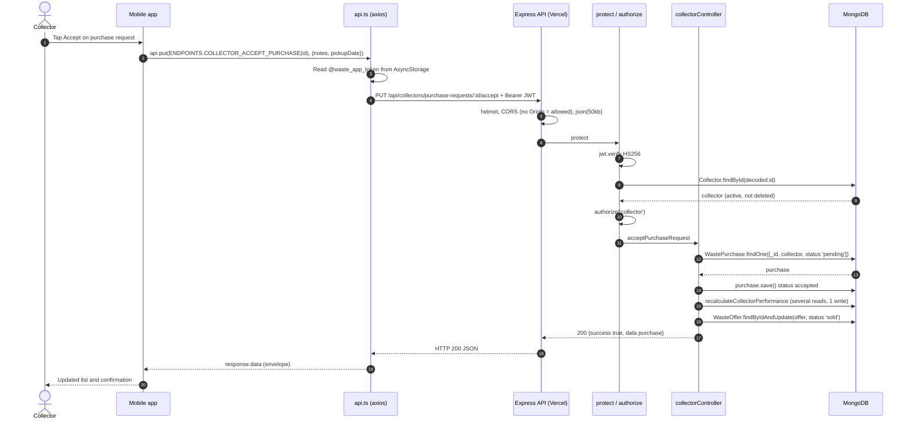

### 9.3 Sequence: failure (token invalidated after a password reset)

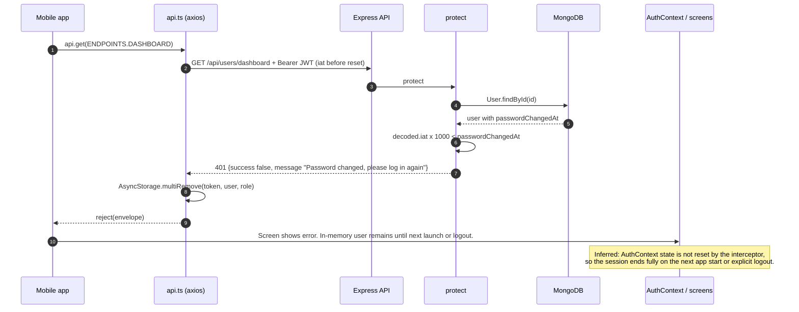

The same path handles expired tokens (`jwt.verify` throws → 401), deleted accounts (401) and deactivated accounts (**403**, which does *not* clear stored auth). Handlers deliberately return **400** rather than 401 for user-correctable errors such as a wrong current password, an invalid reset code or an upload problem, so the client does not sign the user out. [V] Comments in `authController.js` and `upload.js` say so.

---

## 10. API Architecture

### 10.1 Organisation and conventions [V]
- Base path `/api`, grouped by actor: `/auth`, `/users`, `/collectors`, `/vendors`, `/admin`, plus `/chat` and `/config`. A health/info document lives at `GET /`.
- Each role router applies `router.use(protect)` + `router.use(authorize(role))` once. The admin router also attaches `requirePermission` per route.
- Envelope: `{ success: boolean, data?, message?, count?, token? }`. The admin transactions endpoint adds `total, page, limit, pages, statuses, summary, countsByType`.
- **Versioning:** none (no `/v1`). **API documentation:** none (no OpenAPI/Swagger). The endpoint inventory below and the `@route` comments in controllers are the only reference.
- **Pagination:** only `GET /api/admin/transactions` (`page`, `limit` ≤ 200) and `GET /api/users/leaderboard` (`limit` ≤ 200). All other lists are unbounded. Filtering uses query strings (`wasteType`, `city`, `status`, `search`, ...). Sorting is fixed, except `browseUserOffers` `sortBy`.
- **Rate limiting:** only `/api/auth/register`, `/register/user`, `/login`, `/forgot-password` and `/reset-password` (10 per 15 min, standard headers). The store is in memory, so on serverless each instance counts separately. [I]

### 10.2 Endpoint groups (summary)
There are 98 API routes plus `GET /`. The **complete inventory** (method, path, purpose, guard, handler) is in [api-architecture.md](api-architecture.md#endpoint-inventory).

| Group | Mount | Routes | Guard | Handler file | Main client |
|---|---|---|---|---|---|
| Auth | `/api/auth` | 10 | public (5, rate limited) / `protect` (5) | `authController.js` | mobile, portal (login, forgot and reset password) |
| Users | `/api/users` | 16 | `protect` + `authorize('user')` | `userController.js` | mobile `(tabs)` |
| Collectors | `/api/collectors` | 24 | `protect` + `authorize('collector')` | `collectorController.js` | mobile `(collector-tabs)` |
| Vendors | `/api/vendors` | 16 | `protect` + `authorize('vendor')` | `vendorController.js` | mobile `(vendor-tabs)` |
| Admin | `/api/admin` | 30 | `protect` + `authorize('admin','superadmin')` + `requirePermission` | `adminController.js`, `adminAccessController.js` | portal |
| Chat (legacy) | `/api/chat` | 1 | `protect` + participant check | inline in `routes/chat.js` | none found [V] |
| Config | `/api/config` | 1 | public | inline in `routes/config.js` | mobile `AppConfigContext` |

**Endpoints with no client reference found:** [V] by searching `frontend/` and `my-app/`. These are `/auth/register/user`, `/users/transactions`, `/users/challenges`, `/users/challenges/:id/join`, `/users/badges`, `/collectors/verify-dropoff` (the app uses the `/record-collection` alias), `/collectors/transactions`, `/collectors/reports`, `/vendors/rewards*`, `/vendors/redemptions*`, `/vendors/analytics`, `/chat/history/:roomId`, and admin `/challenges`, `/badges` and `/analytics`. They are reachable and should be treated as live attack surface.

### 10.3 Error conventions [V]

| Status | Used for |
|---|---|
| 400 | Missing or invalid input; business-rule violations (already processed, out of stock); user-correctable auth errors (wrong current password, bad reset code) |
| 401 | No or invalid token, expired, password changed since issue, account deleted, bad login credentials |
| 403 | Wrong role, missing admin permission, deactivated account, not the owner of a resource |
| 404 | Not found, or not owned (ownership-scoped queries return 404, not 403) |
| 429 | Rate-limit exceeded (express-rate-limit) |
| 500 | Unhandled exception. Body includes `error.message` from controller catches. |
| 502 | Profile photo upload failed upstream (Cloudinary) |

---

## 11. Database and Data Architecture

### 11.1 Engine and access
MongoDB via Mongoose 8. One connection per process is opened at module load by `connectDB()`, which calls `process.exit(1)` on failure. [V] A `setInterval` pings the server every 30 s as a "free tier keep-alive". [V] On serverless this only runs while an instance is warm. [I] There are **no migrations framework, no multi-document transactions, and no change streams**. [V]

### 11.2 Collections
19 model files. `UserOffer.js` is **empty** (0 bytes) and defines no model. [V] So there are 18 real collections:

| Collection (model) | Responsibility | Key constraints and indexes (DB-enforced) |
|---|---|---|
| `users` (User) | Household accounts, points, cash, QR | `email` unique; `qrCode` unique sparse |
| `collectors` (Collector) | Collector accounts, location, accepted types, totals, rating, performance | `email` unique; `location` 2dsphere |
| `vendors` (Vendor) | Vendor accounts, rating | `email` unique; `location` 2dsphere |
| `admins` (Admin) | Admin accounts | `email` unique |
| `adminroles` (AdminRole) | RBAC roles | `name` unique; `key` unique |
| `userwasteoffers` (UserWasteOffer) | User listings | {user,status}, {wasteType,status}, `location.coordinates` 2dsphere (declared twice) |
| `collectorpurchaserequests` | Collector bids on user offers | {userOffer,status}, {collector,status}, {user,status} |
| `wasteoffers` (WasteOffer) | Collector listings to vendors | `location` 2dsphere; {status,expiresAt} |
| `wastepurchases` (WastePurchase) | Vendor purchase requests | `location` 2dsphere only |
| `wastetransactions` (WasteTransaction) | QR drop-offs | {user,createdAt}, {collector,createdAt}, {status} |
| `rewards` (Reward) | Vendor reward catalogue | {isActive,validUntil}, {vendor} |
| `rewardredemptions` | Issued codes | `redemptionCode` unique; {user,createdAt}; {status} |
| `challenges` | Challenges with embedded participants | {isActive,endDate}, {type} |
| `badges` | Badge definitions, `earnedBy[]` | `name` unique |
| `ratings` (Rating) | Star ratings | {rater,relatedId} **unique**; {ratee,rateeRole} |
| `vendorpricings` | One pricing doc per vendor | `vendor` unique |
| `appconfigs` (AppConfig) | Runtime config key/value | `key` unique |
| `chatmessages` (ChatMessage) | Legacy Socket.IO chat | `roomId` index |

Index creation relies on Mongoose `autoIndex` (default on). Whether the indexes exist in the deployed database is [U].

### 11.3 Entity-relationship overview

**What it shows:** relationships only. The attribute-level ERD is in [database.md](database.md#full-erd). All references are Mongoose `ObjectId` refs: **none are enforced by MongoDB**, and there are no cascading deletes.

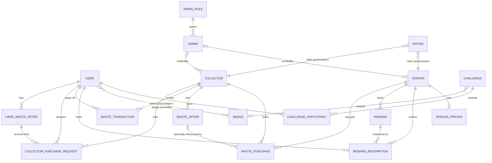

`Rating.rater`/`ratee` and `ChatMessage.senderId`/`roomId` are **polymorphic**: the role field says which collection the id refers to. There is no `ref`. [V]

### 11.4 Consistency and transaction boundaries
- **Each `save()`/`updateOne` is its own atomic unit.** Multi-document workflows such as pickup completion (request → offer → user → collector), redemption (redemption → user points → reward stock → vendor counter) and account deletion run sequentially, with **no rollback** if a later step fails. [V]
- **Check-then-act without atomic conditions:** `redeemReward` reads `req.user.points` and then saves. `purchaseWaste` reads `offer.status === 'available'` and then saves `reserved`. Concurrent requests can double-spend points or double-reserve an offer. [I] This follows from the code shape; it has not been reproduced.
- **Derived data:** collector inventory is computed on read from `WasteTransaction`, `WasteOffer` and `WastePurchase`, and vendor inventory from completed `WastePurchase`s. Counters such as `Collector.totalWasteCollected`, `User.points` and `Vendor.averageRating` are denormalised and updated imperatively. [V]
- **Known divergence:** `completeUserWastePickup` writes `collector.inventory[...]`, but `Collector` has no `inventory` path. Under Mongoose's default strict mode it is **not persisted** [I], and `getInventory` reads only drop-off `WasteTransaction`s. [V] As a result, waste bought through the user marketplace never appears in the collector's inventory screen.

### 11.5 Lifecycle and deletion
- **Accounts** are soft-deleted and anonymised by admins (§19.6). There is no hard delete. Admin lists filter `deletedAt: null`. [V]
- **Offers and requests** normally move to `cancelled` rather than being deleted. For example, `DELETE /users/offers/:id` sets `cancelled`. [V] **The exception is `DELETE /collectors/offers/:id`, which hard-deletes the `WasteOffer` (`offer.deleteOne()`) whatever its status.** A `reserved` offer can therefore disappear while a `WastePurchase.offer` still references it. [V]
- **Reset codes** expire after 15 minutes but are only cleared on use, failure or deletion. **Redemptions** are marked `expired` lazily, when a vendor tries to verify them. [V]
- **Retention:** no TTL indexes or archival. Cloudinary offer media is never deleted. Old profile photos are destroyed when replaced or removed. [V]
- **Seeding:** `npm run seed` performs `deleteMany` on seven collections and creates demo accounts with hard-coded passwords. It is dangerous against production. [V]

---

## 12. Authentication and Authorization

### 12.1 Mechanisms [V]
- **Credentials:** bcrypt (salt rounds 10) in a `pre('save')` hook on all four account models. The password field is `select: false`. The minimum length is 6, with no other complexity rule.
- **Tokens:** HS256 JWT `{ id, role }`, `expiresIn: JWT_EXPIRE || '7d'`. There are no refresh tokens, no server-side session store, and no revocation list. Logout is client-side only.
- **Revocation by time:** `protect` rejects tokens with `iat` earlier than `passwordChangedAt`. That field is set by password reset and account deletion. **`changePassword` does not set it**, so existing tokens survive a password change. [V]
- **Mobile storage:** token, user and role in AsyncStorage (unencrypted platform storage). [V]
- **Portal storage:** token written to a JS-readable cookie `ecodash_admin_token` (`max-age=86400`, no `Secure`/`SameSite`/`HttpOnly` flags set in code) **and** to `localStorage`. [V] [my-app/app/login/page.tsx](../../my-app/app/login/page.tsx)
- **Portal edge check:** `middleware.ts` verifies the cookie with `jose` using `JWT_SECRET`. **If that variable is unset it falls back to a hard-coded literal**, and the same literal appears in `FEATURES.md`. [V] The value is deliberately not reproduced here. The middleware does not check the token's `role`. [V]

### 12.2 Authorisation model
- **Roles:** user, collector, vendor and admin are hard separations by router (`authorize`).
- **Admin RBAC:** 24 permission keys in [backend/config/adminPermissions.js](../../backend/config/adminPermissions.js). There are three built-in roles. **Executive** always has every permission, including keys added later. **Manager** and **Admin** get their defaults once (`seededPermissions`). Custom roles can be created. An admin with no role is migrated to Executive on first access. Safeguards [V]: at least one active Executive must always remain, admins cannot change their own role or deactivate themselves, built-in roles cannot be renamed or deleted, and the Executive role's permissions cannot be edited.
- **Frontend route protection:** in mobile, `app/index.tsx` redirects by stored role. Route groups are not otherwise guarded, and the backend is the enforcement point. In the portal, the edge middleware handles authentication and `useAccess().can()` hides UI. [V]

### 12.3 Authentication sequence (mobile login and protected call)

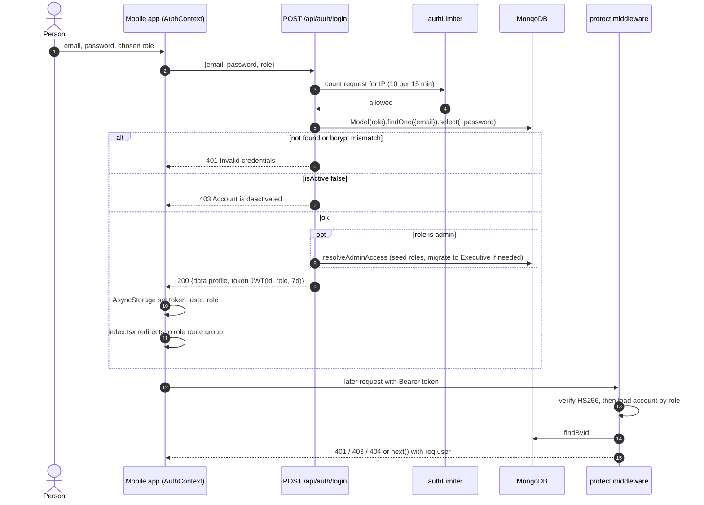

### 12.4 Admin portal authentication

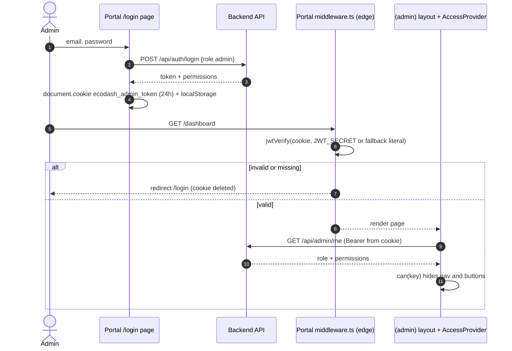

### 12.5 Risks and missing controls
Missing controls: refresh-token rotation and server-side logout, MFA for admins, account lockout on login (only the IP rate limit applies), password-change token invalidation, `HttpOnly` cookie, email verification at sign-up, and approval for self-registered collectors. Self-registered collectors are `isVerified: true` by default. Full analysis is in [security-architecture.md](security-architecture.md).

---

## 13. External Integrations

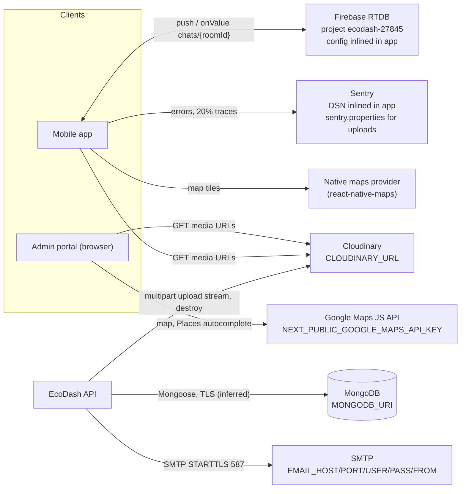

| Integration | Purpose | Client / adapter | Data exchanged | Auth (no secrets) | Failure handling | Config source | Risk |
|---|---|---|---|---|---|---|---|
| MongoDB | System of record | Mongoose ([backend/config/db.js](../../backend/config/db.js)) | All domain data | Credentials in `MONGODB_URI` | Connection failure → `process.exit(1)`. Per-query errors → 500. No retry. | env | SPOF. Free tier noted in a code comment. |
| Cloudinary | Offer media and profile photos | `multer-storage-cloudinary`, `cloudinary.v2` | Images and videos in; URLs out. Folders `ecodash/offers/{images,videos}`, `ecodash/profiles` | `CLOUDINARY_URL` | Offer upload errors → Express error handler (500, or the message in dev). Profile → 400/502. Old photo deletion is best-effort. | env (**missing from `.env.example`**) | Uploads stream through the serverless function (body and time limits [U]) |
| SMTP (nodemailer) | Welcome, reset code, status change, deletion emails | [backend/utils/email.js](../../backend/utils/email.js) | Recipient, name, HTML. **The welcome email contains the initial password in plain text.** | `EMAIL_USER`/`EMAIL_PASS` | Skipped with a warning if unset. Reset: a failure clears the code. Status and deletion: logged, never fatal. No retry or queue. | env | Default host is Gmail SMTP |
| Firebase RTDB | Chat | `firebase/database` ([frontend/services/firebase.ts](../../frontend/services/firebase.ts)) | `{senderId, senderName, senderRole, text, createdAt}` under `chats/{roomId}` | **None.** Rules in [database.rules.json](../../database.rules.json) allow public read and write. Whether they are deployed is [U]. | SDK handles reconnection. No server involvement. | inlined config | Confidentiality and integrity of chat |
| Sentry | Mobile crash and error monitoring | `@sentry/react-native` | Errors, sessions, 20 % traces; email and IP stripped in `beforeSend` | DSN (public by design); upload credentials via `sentry.properties` | Disabled in dev | inlined + `app.json` plugin | Low |
| Google Maps | Portal collector location picker | `@react-google-maps/api` | Map loads, Places autocomplete | Browser API key from `NEXT_PUBLIC_GOOGLE_MAPS_API_KEY` | Empty key → map fails to load | env | Key restrictions are [U] |
| Native maps / location | Mobile map of collectors, directions | `react-native-maps`, `expo-location` | Device location (on device) | Provider key configuration [U] | — | native config | — |
| Vercel | Hosting | `vercel.json` | — | — | — | Vercel project settings [U] | Cold starts, function limits |
| Expo EAS | Cloud builds | `eas.json` | Source and credentials | Expo account | — | `app.json` `extra.eas.projectId` | — |

---

## 14. Deployment and Infrastructure Architecture

### 14.1 Environments

| Environment | Evidence | Status |
|---|---|---|
| Local development | `npm run dev` (nodemon, port 3000), `expo start` (Metro 8081), `pnpm dev -p 3001`; CORS allows the localhost origins | [V] |
| Production | Backend at a `*.vercel.app` URL hard-coded in both clients. Portal origin `*.vercel.app` in CORS. | [V] URLs in code; [U] project settings and env values |
| Staging / test | **None identified.** EAS has `development`/`preview`/`production` *build* profiles, but they all point at the same hard-coded API URL. | [V] |

### 14.2 Deployment and network topology

**What it shows:** where each part runs, ports and protocols. Elements without repository evidence are labelled as unverified.

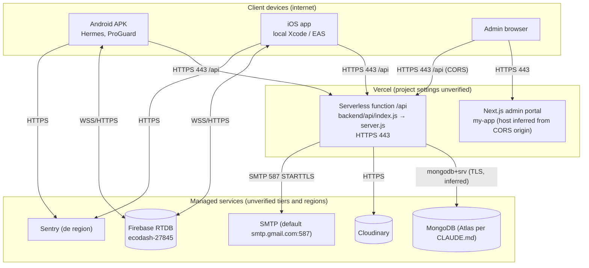

### 14.3 Build and release
There is **no CI/CD**: no `.github/workflows`, no Dockerfile, no infrastructure-as-code. [V] Release steps are manual and are covered in [deployment-architecture.md](deployment-architecture.md):
- **Backend:** Vercel project deployment (Git integration or CLI is [U]). `vercel.json` only rewrites routes.
- **Portal:** Next.js build (`pnpm build`). It is hosted at the CORS-allowlisted Vercel origin [I]. `next.config.ts` defines an `/api/*` rewrite to the backend, but `lib/api.ts` calls the backend URL directly, so the rewrite is unused. [I]
- **Mobile:** EAS Build profiles (APK for every Android profile, `autoIncrement` in production) or local `build-release.sh` (Gradle `assembleRelease`) and Xcode builds. Local builds need the native `android/` and `ios/` folders, which are generated by Expo prebuild and **git-ignored**. [V] Store submission is not configured (`submit.production: {}`).
- **Database changes:** none are migrated. Schema changes take effect on deploy, and backfills are manual scripts (`recalculate-performance.js`). AppConfig defaults are seeded lazily by `getAppConfig`, and admin roles lazily by `ensureDefaultRoles`.
- **Rollback:** relies on Vercel's deployment history [U]. Mobile builds cannot be rolled back once installed.

---

## 15. Security Architecture

### 15.1 Trust boundaries

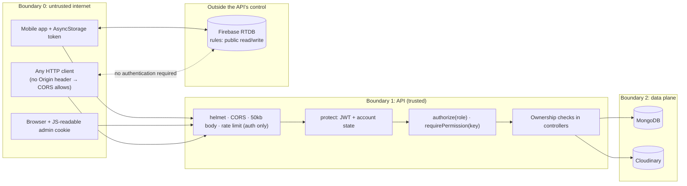

### 15.2 Summary
The full assessment is in [security-architecture.md](security-architecture.md).

**Verified controls:** bcrypt hashing; `select:false` password; HS256 pinned in `jwt.verify`; account-state checks on every request; token invalidation after reset and deletion; reset codes hashed (SHA-256), 15-minute TTL, 5-attempt cap, timing-safe compare, non-enumerating response; auth rate limiting; helmet; CORS allowlist; 50 kB JSON limit; escaped regex in admin search; upload MIME and size filters; admin RBAC enforced on the backend with lock-out safeguards; Sentry PII scrubbing; HTML-escaping in status and deletion emails.

**Potential vulnerabilities (evidence-backed):**
1. Firebase `chats` readable and writable by anyone, with sender identity client-asserted. [V] config; deployment [U]
2. Hard-coded JWT secret fallback in portal middleware, also printed in a tracked doc. Exploitable only if the backend uses the same value. [V] code; [U] runtime
3. Anyone can self-register as a collector (`POST /api/auth/register` `role:'collector'`, `isVerified` defaults to `true`). A collector can then credit **arbitrary points** to **any user id** (`verifyDropoff`) and set an arbitrary `cashAmount`. [V]
4. Race conditions on points and offer reservation (no atomic conditional updates). [I]
5. Admin token stored in a JS-readable cookie and `localStorage`, so any XSS in the portal exposes it. [V] storage; no XSS was found in this review.
6. Controller `catch` blocks return raw `error.message` (internal details) even in production. [V]
7. `getUserByQR` accepts a raw ObjectId as the "QR". QR payloads are unsigned. Any collector can look up any user's name, email and phone by id. [V]
8. Welcome email sends the initial password in plain text, with an unescaped name in the HTML. [V]
9. `changePassword` does not invalidate existing tokens. [V]

**Needs runtime verification:** deployed RTDB rules, the production `JWT_SECRET` value, whether the portal sets `JWT_SECRET`, Vercel environment variables, Cloudinary unsigned-upload settings, Google Maps key restrictions, MongoDB network access list, and dependency vulnerabilities (`npm audit` was **not run**).

---

## 16. Error Handling and Observability

| Concern | Current state | Evidence |
|---|---|---|
| Exception handling | Per-handler `try/catch` → `500 { success:false, message: error.message }`. Express 5 forwards async errors to the global handler, which hides messages when `NODE_ENV=production`. | [V] `server.js` |
| Error propagation to clients | Mobile: axios rejects with the server envelope or a message string. A 401 clears stored auth. Portal: pages check `res.success`. | [V] |
| Frontend loading and error states | Per-screen `loading` state and `Alert.alert`. Root spinner while the session loads. `AppConfigContext` falls back silently to constants. | [V] |
| Logging | `console.log`/`console.error` only, no levels or structure. Some handlers log request details (e.g. `completeUserWastePickup`, `getNearbyCollectors`). On Vercel these go to function logs [I]. | [V] |
| Monitoring and tracing | **Mobile:** Sentry (errors, sessions, 20 % traces, release tag). **Backend and portal:** none. | [V] |
| Metrics and alerting | None in the repo. Anything configured in the Vercel, Atlas or Sentry dashboards is [U]. | [V] / [U] |
| Health check | `GET /` returns static JSON. It does **not** check DB connectivity. | [V] |
| Timeouts and retries | Axios 10 s timeout. No retries anywhere. No explicit Mongo or SMTP timeouts (library defaults). | [V] |
| Recovery tools | `recalculate-performance.js` (backfill), `create-admin.js reset` (admin password reset). | [V] |
| Audit trail | **None.** Admin actions (deletion, deactivation, role changes, config edits) are not logged to a store. Only `verifiedBy` and timestamps exist. | [V] |

---

## 17. Testing Architecture

**Finding:** CLAUDE.md states "There is no test suite", but that is **out of date**. [V] `frontend/` has a Jest suite: [frontend/jest.config.js](../../frontend/jest.config.js) (preset `jest-expo`) and [frontend/jest.setup.ts](../../frontend/jest.setup.ts), which mocks AsyncStorage, Sentry, Firebase, camera, location, image picker, haptics and icons. Shared fixtures live in `__tests__/setup/` (`apiMock.ts` fakes both the axios envelope and `fetch`, plus `factories.ts`, `alert.ts` and `interactions.ts`). Scripts: `npm test`, `test:watch`, `test:coverage`.

**Executed during this review:** `npx jest` → **29 suites, 340 tests, all passed** (≈3.8 s). Coverage was not measured.

| Suite folder | Focus |
|---|---|
| `components/` | OfferFilters, PerformanceBadge, ProfilePhoto, RatingModal, help |
| `context/` | AuthContext, LanguageContext |
| `flows/` | launch/session restore |
| `forms/` | login, register, scan-collection, numeric validation, login language |
| `screens/` | change-password, chat rooms, edit-profile, guide, map, offer call, requests, user profile |
| `services/` | api.ts interceptor behaviour |
| `utils/` | chatRoom, distance, locales, offerFilters, onboarding, performance, phone |

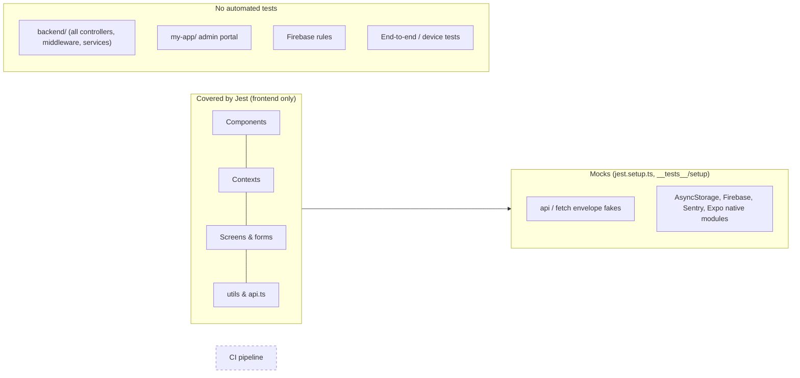

**Gaps:** no backend tests at all, which covers money, points, RBAC and deletion logic. There are also no portal tests, no API contract tests, no E2E or device tests, no RTDB rules tests, and no CI to run any of them.

---

## 18. Performance, Scalability and Reliability

### 18.1 Existing characteristics [V unless marked]
- **Stateless API:** JWT auth with no session store, so instances scale horizontally on Vercel. [I] The exceptions are the in-memory rate limiter (per instance) and the memoised `ensureDefaultRoles` promise (per instance, harmless).
- **Indexed hot paths:** offers by status and type, requests by `{collector|user|userOffer, status}`, transactions by `{user|collector, createdAt}`, redemption code (unique), rating uniqueness.
- **Uploads stream to Cloudinary** rather than buffering to disk.

### 18.2 Bottlenecks and expensive operations
| Location | Issue |
|---|---|
| `adminController.getDashboard` | Loads **every** verified `WasteTransaction` and every completed `CollectorPurchaseRequest` (populated) and sums in JS. That is O(all history) per page view. |
| `adminController.getAnalytics`, vendor and collector `getReports`/`getAnalytics` | Same pattern, plus per-collector lookups. |
| `browseUserOffers`, `vendor getOffers`, `getNearbyCollectors`, admin list endpoints | Unbounded result sets with `populate`. The 2dsphere indexes exist but are **unused**: comments say location filters were removed. |
| `collectorPerformance` | Recomputed synchronously after several write paths and on dashboard load (multiple counts and an aggregation). |
| `getInventory` | Four unbounded finds per call. |
| `server.js` keep-alive ping | `setInterval` in a serverless function: ineffective when frozen, and keeps work running while warm. [I] |
| Cold starts | Every new instance opens a Mongo connection and runs role seeding on the first admin request. [I] |

### 18.3 Single points of failure and resilience
MongoDB (process exits if unreachable at start), the hard-coded backend URL in both clients (no failover), the single Firebase project, and the single SMTP account. There are no retries, circuit breakers or queues. Email is sent inline, which adds latency to deletion, status-change and reset requests.

### 18.4 Scaling options [R]
Add pagination to every list endpoint; move dashboard and analytics to `$group` aggregations or pre-computed counters; use conditional atomic updates (`findOneAndUpdate` with a status or points predicate) or Mongo transactions; move email and performance recompute to a background job; use a shared rate-limit store (e.g. Redis/Upstash) if staying on serverless; restore geo queries where "nearby" semantics are intended.

---

## 19. Important End-to-End Workflows

### 19.1 User → collector deal (primary marketplace)
**Trigger:** a user posts an offer. **Components:** mobile `(tabs)/create-offer`, `(collector-tabs)/user-offers`, `requests`; `userController`, `collectorController`; D3, D1, Cloudinary.

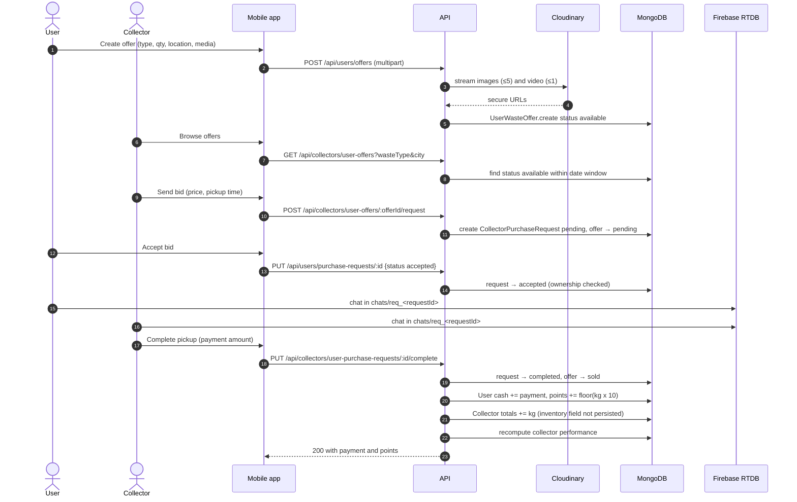

**Failure and recovery:** because the first bid moves the offer to `pending` and new bids require `available`, **only one bid can be open per offer at a time**. Bidding is first-come, not competitive. [V] If the collector cancels, the offer returns to `available`. **Gap** [V]: when the user *rejects* a bid, the offer stays `pending`, because the reject path does not reset it. Browse filters on `status: 'available'`, so no other collector can find it until the user cancels and re-lists it. A partial failure during completion leaves inconsistent documents, with no compensation.

### 19.2 Offer / request state activity

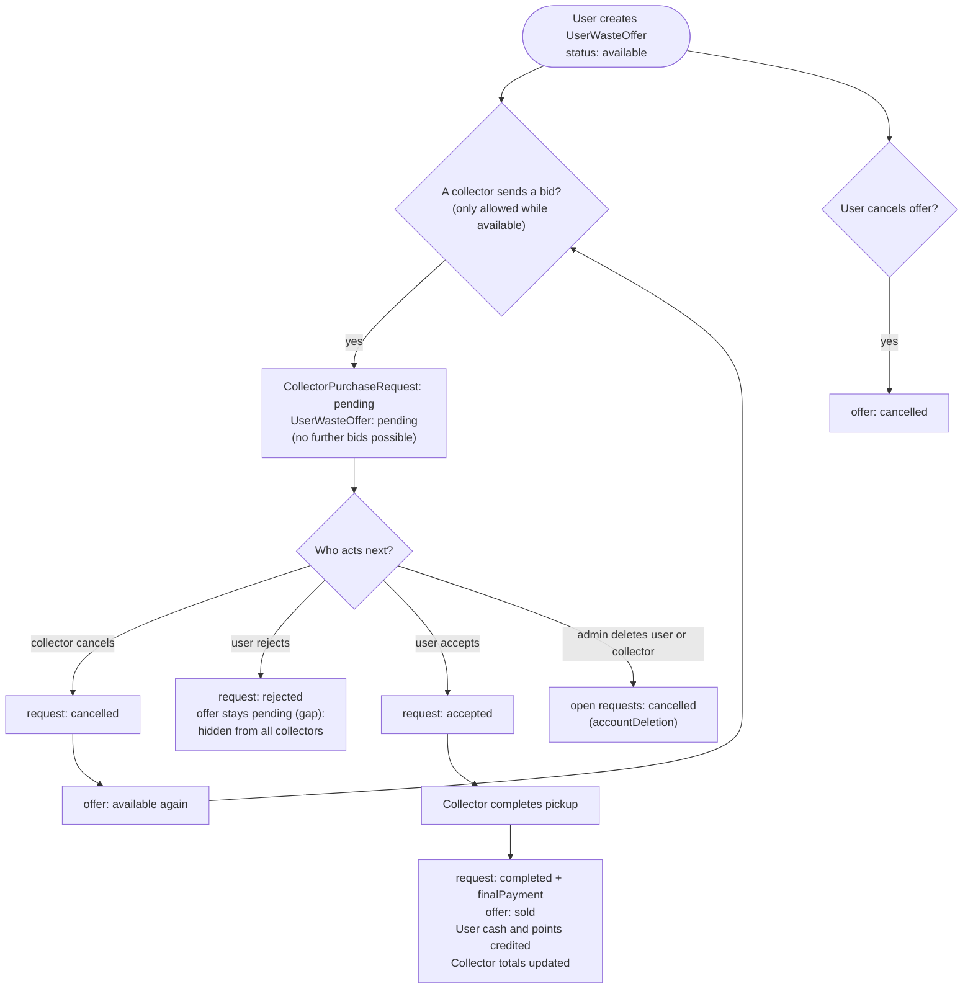

### 19.3 QR drop-off
**Trigger:** a collector scans a user's QR code in `(collector-tabs)/scan`. `POST /collectors/verify-qr` resolves the user (JSON `{userId}` payload, raw id, or stored `qrCode` data URL). Then `POST /collectors/record-collection` creates a verified `WasteTransaction`. For points, it credits `calculatePoints()` (a hard-coded table in [backend/utils/helpers.js](../../backend/utils/helpers.js), **not** AppConfig) and evaluates `waste_quantity` badges. For cash, it credits the client-supplied `cashAmount`, which the app computes from `useAppConfig().cashPerKg`. It updates collector totals and the performance score. A wrong waste type returns 400, and an unknown user returns 404. There is no idempotency key, so a double-tap records two transactions. [I] See [data-flow.md §2-C](data-flow.md#2-c-qr-drop-off).

### 19.4 Collector → vendor purchase
`POST /vendors/purchase`: with an `offerId`, the offer becomes `reserved`. The collector then accepts (offer `sold`), rejects (offer `available`) or counter-offers (`collectorResponse.counterPrice`; the vendor has **no endpoint to accept a counter-offer** [V]). Completion (`/complete`) sets `completed` and `actualPickupDate`. Vendor inventory is the sum of completed purchases. The vendor can cancel while the purchase is pending or accepted. The offer is released even if it was already `sold`. See [data-flow.md §2-D](data-flow.md#2-d-collector--vendor-purchase).

### 19.5 Reward redemption
A vendor creates a `Reward`. A user calls `POST /users/rewards/:id/redeem`, which checks active, valid, stock and points. It generates an 8-hex code and a QR data URL, creates a `RewardRedemption` (expiring at the reward's `validUntil`), deducts points, and increments `redeemed`, stock and `vendor.totalRedemptions`. The vendor then calls `POST /vendors/redemptions/:code/verify` → `used`, or lazily `expired`. The vendor redemption routes have **no client reference** in the mobile app [V], so verification may be unused in practice. [I]

### 19.6 Admin account deletion
`DELETE /api/admin/{users|collectors|vendors}/:id` requires `<x>.delete`. `deleteAccount()` cancels the account's open offers, requests and purchases (vendors: deactivates rewards). It replaces name, email and phone, unsets personal fields and reset fields, sets a random password, sets `isActive:false`, `deletedAt` and `passwordChangedAt` (killing all tokens), then emails the original address with the reason and support contact. The record is kept so history still resolves. Failure modes: the email failure is reported as `emailSent:false`, and a mid-way DB failure leaves a partial cancellation. See [data-flow.md §2-F](data-flow.md#2-f-admin-account-deletion-with-rbac).

### 19.7 Password reset
`POST /auth/forgot-password {email, role}` (rate limited). If the account exists and is active, it creates a 6-digit code (stored as a SHA-256 hash, 15-minute TTL) and emails it. If the email fails, the code is cleared. The response is the same either way. `POST /auth/reset-password` checks expiry and attempts (≤5) and does a timing-safe compare. It then sets the password, back-dates `passwordChangedAt` by 1 s, and clears the code. Used by both the mobile app and the portal. See [data-flow.md §2-A](data-flow.md#2-a-authentication--password-reset).

### 19.8 Chat
The room id comes from [frontend/utils/chatRoom.ts](../../frontend/utils/chatRoom.ts) (`req_<CollectorPurchaseRequest id>` or `pur_<WastePurchase id>`). Screens subscribe with `onValue(query(ref(db, 'chats/'+roomId), orderByChild('createdAt')))` and write with `push`. The backend is not involved, so there is no moderation, persistence guarantee, membership check or notification. [V]

---

## 20. Architectural Decisions and Trade-offs

Rationales marked *hypothesis* are inferred. The repository does not record the reasons behind these decisions.

| Decision | Evidence | Benefits | Limitations | Alternatives |
|---|---|---|---|---|
| One collection per role; role carried in the JWT | four account models; switch in `protect`, `login`, `chatHandler` | Role-specific schemas and validation | Same email can exist under several roles (registration only checks user, collector and vendor). Every role change touches several switches. Cross-role queries need unions. | Single `accounts` collection with a discriminator |
| Serverless hosting on Vercel (*hypothesis: zero-ops, free tier*) | `vercel.json`, `api/index.js` | No server management, HTTPS by default | Socket.IO unusable; per-instance rate limits; cold starts; `setInterval` ineffective; function time and body limits for uploads [U] | Long-running Node host (Render, Fly, ECS) |
| Chat through Firebase RTDB directly from clients (*hypothesis: realtime without a socket server*) | chat screens, `database.rules.json` | Realtime, offline-tolerant, no backend load | No auth (open rules); duplicates the Socket.IO/Mongo implementation; history not in the system of record | Firebase Auth custom tokens minted by the API + rules; or a hosted socket service |
| Derived inventory (computed on read) | `getInventory`, `getVendorInventory` | No stock counters to drift | Expensive at scale. Marketplace pickups are excluded from collector inventory. | Ledger collection or atomic counters |
| Runtime config in MongoDB, defaults in two places | `routes/config.js`, `adminController DEFAULT_CONFIGS`, `frontend/constants/config.ts` | Admins change categories and rates without a release | **The backend does not use the configured rates for points.** Defaults are triplicated. | Server-side rate lookup in `calculatePoints` and cash computation |
| Soft delete with anonymisation | `services/accountDeletion.js` | History stays intact; privacy respected; tokens revoked | Many `updateMany`s without a transaction | Transaction-wrapped deletion |
| Hard-coded API base URLs | `constants/config.ts`, `my-app/lib/api.ts`, `next.config.ts` | Simple | No environment separation; editing source to develop locally | `EXPO_PUBLIC_API_URL` / `NEXT_PUBLIC_API_URL` |
| Admin RBAC catalog in code, roles in DB | `adminPermissions.js`, `adminAccess.js` | Single source of truth; auto-seeding; safe defaults for new keys | Seeding runs per cold start (cheap upserts) | — |

---

## 21. Architectural Risks and Technical Debt

Severity: **Critical / High / Medium / Low**. Status: **Confirmed** (visible in code), **Potential** (depends on runtime or concurrency), **Investigate**. Effort: S (< 1 day), M (1–3 days), L (> 3 days).

| # | Risk / issue | Evidence | Impact | Likelihood | Severity | Status | Mitigation [R] | Effort |
|---|---|---|---|---|---|---|---|---|
| 1 | Chat database publicly readable and writable; sender identity spoofable | `database.rules.json`; `chat.tsx` writes `senderId` from the client | Disclosure of all conversations, impersonation, spam or data wipe | High if the rules are deployed | **Critical** | Confirmed (config) / runtime [U] | Firebase Auth via custom tokens from the API; rules restricting `chats/$room` to participants and validating `senderId == auth.uid` | M |
| 2 | Self-registered collectors can mint points and cash for any user | `register` accepts `role:'collector'`; `isVerified` default `true`; `verifyDropoff` trusts `userId` and `cashAmount` | Reward fraud; cash liabilities | Medium | **High** | Confirmed | Collectors created by admins only (or `isVerified:false` + gate on routes); compute cash server-side from AppConfig; per-transaction caps; audit log | M |
| 3 | Hard-coded JWT secret fallback in portal, also published in FEATURES.md | `my-app/middleware.ts`, `FEATURES.md` | If production shares it, any role's token can be forged | Unknown | **High** (Critical if the value is in use) | Potential | Remove the fallback (fail closed); rotate `JWT_SECRET`; scrub the doc | S |
| 4 | Non-atomic multi-step updates and check-then-act races | `redeemReward`, `purchaseWaste`, `completeUserWastePickup`, `deleteAccount` | Double-spent points, double-reserved offers, partial state | Low–Medium | **High** | Potential | Conditional `findOneAndUpdate` (`points: {$gte}`, `status:'available'`); Mongo transactions | M |
| 5 | Configured points and cash rates not used by the backend | `helpers.calculatePoints` hard-coded; pickup points `×10`; cash from client | Admin config misleads; inconsistent rewards | High | **Medium** | Confirmed | Read `points_per_kg`/`cash_per_kg` from AppConfig on the server | S |
| 6 | Marketplace pickups missing from collector inventory | `collector.inventory` not in schema; `getInventory` reads only `WasteTransaction` | Collector cannot sell bought waste via inventory | High | **Medium** | Confirmed (read path) / Inferred (write drop) | Record pickups as ledger entries (e.g. a `WasteTransaction` with a source field) | M |
| 7 | Rejected bid leaves the offer `pending` | `respondToPurchaseRequest` | Offer disappears from the market | High | **Medium** | Confirmed | On reject, revert to `available` when no other pending or accepted bid exists | S |
| 8 | Admin JWT in a JS-readable cookie and localStorage; middleware ignores role; no `Secure`/`SameSite` flags | `login/page.tsx`, `middleware.ts` | Token theft via XSS | Low | **Medium** | Confirmed | HttpOnly cookie set server-side (route handler); check `role` claim | M |
| 9 | Raw error messages in 500 responses | controller `catch` blocks | Information disclosure | Medium | **Medium** | Confirmed | Generic messages in production; log details | S |
| 10 | No backend or portal tests; no CI | repository | Regressions in money and RBAC logic | High | **Medium** | Confirmed | Jest + supertest + mongodb-memory-server; GitHub Actions running lint, typecheck and tests | L |
| 11 | Unbounded queries and in-memory aggregation | admin dashboard and analytics, browse endpoints | Slow pages, serverless timeouts as data grows | Medium (grows) | **Medium** | Confirmed | Pagination, `$group` aggregations, projections | M |
| 12 | `changePassword` keeps old tokens valid; 7-day tokens; no server-side logout | `authController.changePassword` | Stolen tokens stay usable | Low | **Medium** | Confirmed | Set `passwordChangedAt` on change; shorter access token + refresh | S/M |
| 13 | User contact data exposed by id lookup | `getUserByQR` | Any collector can enumerate known ids | Low | **Medium** | Confirmed | Signed QR payload (HMAC) and minimal fields | S |
| 14 | Plain-text initial password emailed; unescaped name in welcome HTML | `utils/email.js sendWelcomeEmail` | Credential exposure in mailboxes | Medium | **Medium** | Confirmed | One-time set-password link; escape HTML | S |
| 15 | Socket.IO path and Mongo chat history are dead code; socket `join_room` has no membership check | `chatHandler.js`, `routes/chat.js`, unused `socketService.ts` | Confusion; latent vulnerability if revived | Low | **Low** | Confirmed | Remove, or secure and adopt | S |
| 16 | In-memory rate limiter on serverless | `routes/auth.js` | Brute-force limits weaker than configured | Medium | **Low–Medium** | Potential | Shared store; per-account throttling | S |
| 17 | Login email not normalised | `login` uses `findOne({email})` as given; reset normalises | Case-sensitive login failures | Medium | **Low** | Confirmed (code) | Lowercase and trim in login and register | S |
| 18 | Counter-offer cannot be accepted by the vendor; vendor cancel releases an already-`sold` offer; collector can hard-delete a `reserved` offer | `counterOffer`, `cancelPurchase`, `collectorController.deleteOffer` | Dead-end negotiation; resold stock; dangling `WastePurchase.offer` | Medium | **Low** | Confirmed | Add a vendor accept-counter endpoint; release only `reserved` offers; block deleting non-`available` offers | S |
| 19 | Config drift: `.env.example` lacks `CLOUDINARY_URL`, lists unused vars; `express-validator` unused; empty `UserOffer.js`; `VendorPricing.currency` default `USD` vs LKR elsewhere | files cited | Setup errors, confusion | High | **Low** | Confirmed | Clean up | S |
| 20 | Destructive seed script against the configured DB | `seed.js` `deleteMany` | Production data loss by mistake | Low | **Medium** | Confirmed | Refuse to run when `NODE_ENV=production`; require a confirmation flag | S |
| 21 | Hard-coded API URLs; single environment | client config files | No staging; risky testing | High | **Low** | Confirmed | Env-driven URLs and a staging backend | S |
| 22 | Dependency vulnerabilities | not assessed | Unknown | — | — | Investigate | Run `npm audit` / `pnpm audit` in CI | S |

---

## 22. Recommendations and Future Improvements

All items are **[R] Recommended**. None exist today.

**Critical security and reliability fixes**
1. Lock down Firebase RTDB. Mint Firebase custom tokens from the API after JWT auth, and restrict `chats/$roomId` to the two participants (risk 1).
2. Remove the portal's JWT secret fallback and remove the literal from `FEATURES.md`. If the value was ever used in any environment, rotate `JWT_SECRET` (risk 3).
3. Stop public collector and vendor self-registration from minting value. Require admin verification before collector money routes work, and compute cash server-side (risk 2).
4. Make points and stock changes atomic with conditional updates, and wrap multi-document workflows in transactions (risk 4).

**Short-term improvements (days)**
- Use AppConfig rates in `calculatePoints` and the pickup and cash computations (risk 5).
- Fix offer state on bid rejection, the vendor counter-offer accept path, and the cancel-releases-sold-offer bug (risks 7 and 18).
- Generic 500 messages in production; set `passwordChangedAt` on password change; normalise emails (risks 9, 12, 17).
- Update CLAUDE.md (tests exist) and `.env.example` (`CLOUDINARY_URL`). Delete `UserOffer.js` and the unused Socket.IO path, or document them as deprecated.

**Medium-term architectural improvements (weeks)**
- Backend test harness (supertest + in-memory Mongo) with CI running lint, typecheck, the frontend Jest suite and backend tests.
- Inventory ledger covering both QR drop-offs and marketplace pickups (risk 6).
- Pagination and aggregation pipelines for every list and dashboard (risk 11).
- An admin audit log collection written by the admin controllers.
- Environment-driven API URLs and a staging deployment.
- An HttpOnly session cookie for the portal (risk 8).

**Long-term scalability and maintainability**
- Request-schema validation (e.g. zod or express-validator, which is already a dependency) and an OpenAPI description generated from it.
- Background jobs for email, performance scoring and expiry sweeps (offers, redemptions, reset codes).
- Structured logging plus backend error monitoring (Sentry for Node is already used on mobile).
- Revisit the role-per-collection model if roles start to overlap.

A full rewrite is **not** justified. The structure is conventional and the issues are localised.

---

## 23. Glossary and References

### 23.1 Glossary
See §1.4 for domain terms. Technical terms used here: **2dsphere**, a MongoDB geospatial index type. **Envelope**, the response wrapper `{ success, data, message }`. **Cold start**, initialising a new serverless instance. **Soft delete**, marking a record deleted instead of removing it. **Check-then-act**, reading state and then writing it in a separate step, which allows races.

### 23.2 Key source and configuration files

| Area | Files |
|---|---|
| Backend entry and hosting | [backend/server.js](../../backend/server.js), [backend/api/index.js](../../backend/api/index.js), [backend/vercel.json](../../backend/vercel.json), [backend/config/db.js](../../backend/config/db.js), [backend/config/jwt.js](../../backend/config/jwt.js) |
| Routing | [backend/routes/](../../backend/routes/) |
| Auth and RBAC | [backend/middleware/auth.js](../../backend/middleware/auth.js), [backend/services/adminAccess.js](../../backend/services/adminAccess.js), [backend/config/adminPermissions.js](../../backend/config/adminPermissions.js), [backend/models/plugins/passwordReset.js](../../backend/models/plugins/passwordReset.js) |
| Business logic | [backend/controllers/](../../backend/controllers/), [backend/services/](../../backend/services/), [backend/utils/](../../backend/utils/) |
| Data model | [backend/models/](../../backend/models/) |
| Uploads | [backend/middleware/upload.js](../../backend/middleware/upload.js) |
| Mobile | [frontend/app/](../../frontend/app/), [frontend/services/api.ts](../../frontend/services/api.ts), [frontend/services/firebase.ts](../../frontend/services/firebase.ts), [frontend/constants/config.ts](../../frontend/constants/config.ts), [frontend/context/](../../frontend/context/), [frontend/app.json](../../frontend/app.json), [frontend/eas.json](../../frontend/eas.json) |
| Portal | [my-app/middleware.ts](../../my-app/middleware.ts), [my-app/lib/api.ts](../../my-app/lib/api.ts), [my-app/lib/access.tsx](../../my-app/lib/access.tsx), [my-app/next.config.ts](../../my-app/next.config.ts), [my-app/app/](../../my-app/app/) |
| Firebase | [database.rules.json](../../database.rules.json), [firebase.json](../../firebase.json) |
| Tests | [frontend/jest.config.js](../../frontend/jest.config.js), [frontend/jest.setup.ts](../../frontend/jest.setup.ts), [frontend/\_\_tests\_\_/](../../frontend/__tests__/) |
| Existing docs | [CLAUDE.md](../../CLAUDE.md), [FEATURES.md](../../FEATURES.md), [SRS_EcoDash.md](../../SRS_EcoDash.md), [admin-portal-functions.md](../../admin-portal-functions.md), [docs/EcoDash-Overview.md](../EcoDash-Overview.md) |

### 23.3 Documentation versus code: inconsistencies found

| Document claim | Code reality |
|---|---|
| CLAUDE.md: "There is no test suite in any of the three apps" | `frontend/` has 29 Jest suites (340 passing tests). Backend and portal indeed have none. |
| CLAUDE.md: marketplace pickup → "waste lands in collector inventory" | Inventory is derived from drop-offs only. The pickup's inventory write is not in the schema (§11.4). |
| CLAUDE.md: rates "consumed via `useAppConfig()`" | True for the mobile display and the cash *proposed* by the client. The backend's points calculation ignores AppConfig. |
| FEATURES.md: local Multer storage for uploads | Cloudinary (CLAUDE.md already notes this) |
| FEATURES.md contains a JWT secret literal | The same literal is the portal middleware's fallback (§15) |
| `.env.example` | Omits `CLOUDINARY_URL`. Lists `MAX_FILE_SIZE`, `UPLOAD_PATH` and `CLIENT_URL`, which no code reads. |
| `server.js` root endpoint list | Omits `/api/config` |

### 23.4 Traceability matrix

| Claim / diagram | Section | Supporting source |
|---|---|---|
| System context, high-level architecture | 5.1, 5.2 | `backend/server.js`, `frontend/services/{api,firebase}.ts`, `my-app/lib/api.ts`, `frontend/app/_layout.tsx` (Sentry), `my-app/app/(admin)/collectors/page.tsx` (Maps) |
| Backend component diagram | 6.1 | `backend/routes/*.js` imports, `backend/controllers/*.js` requires, `backend/services/*.js` |
| Module dependency diagram | 6.3 | `frontend/constants/config.ts`, `frontend/utils/chatRoom.ts`, `backend/routes/config.js`, `my-app/lib/access.tsx` |
| DFD L0 and L1, store mapping | 7–8 | all models; controllers per process; `middleware/upload.js`; `utils/email.js` |
| Request lifecycle sequences | 9 | `frontend/services/api.ts`, `backend/middleware/auth.js`, `collectorController.acceptPurchaseRequest`, `authController.resetPassword` |
| Endpoint inventory, counts | 10 | `backend/routes/*.js` (98 route definitions + `GET /` in `server.js`) |
| ERD, indexes, constraints | 11 | `backend/models/*.js`, `backend/models/plugins/passwordReset.js` |
| Auth and RBAC | 12 | `backend/middleware/auth.js`, `backend/config/jwt.js`, `backend/services/adminAccess.js`, `backend/controllers/adminAccessController.js`, `my-app/middleware.ts`, `my-app/app/login/page.tsx` |
| Integrations | 13 | `backend/middleware/upload.js`, `backend/utils/email.js`, `frontend/services/firebase.ts`, `database.rules.json`, `frontend/app/_layout.tsx`, `frontend/app.json` |
| Deployment | 14 | `backend/vercel.json`, `backend/api/index.js`, `frontend/eas.json`, `frontend/build-release.sh`, `my-app/next.config.ts`, CORS list in `server.js` |
| Security findings | 15, 21 | as cited per row in §21 |
| Testing | 17 | `frontend/jest.config.js`, `frontend/jest.setup.ts`, `frontend/__tests__/**`, Jest run output |
| Performance findings | 18 | `adminController.getDashboard/getAnalytics`, `collectorController.getInventory`, `userController.getNearbyCollectors`, `utils/collectorPerformance.js` |
| Workflows | 19 | `userController`, `collectorController`, `vendorController`, `services/accountDeletion.js`, `frontend/app/(collector-tabs)/scan.tsx`, `frontend/app/(tabs)/chat.tsx` |

### 23.5 Assumptions, limitations and open questions
- **Validation performed:** every Mermaid block in `docs/architecture/` was rendered with `@mermaid-js/mermaid-cli` 11.4.2. Every linked repository path was checked to exist. The endpoint inventory was reconciled against the route definitions (98 + 1).
- **Not inspected line by line:** bodies of some read-only dashboard and report handlers (`collectorController.getReports`, `vendorController.getAnalytics`, `userController.getDashboard`), most UI screens beyond the workflows cited, and `seed.js` contents beyond its destructive calls.
- **Open questions [U]:**
  1. Are the RTDB rules in `database.rules.json` deployed to `ecodash-27845`?
  2. What `JWT_SECRET` is set on the backend and portal Vercel projects?
  3. Which Vercel projects, regions, Node versions and function limits are in use? Is the portal deployed on Vercel?
  4. MongoDB Atlas tier, region, backups and network access list.
  5. Is `JWT_EXPIRE` overridden in production?
  6. Are the vendor redemption and verification flows used anywhere outside this repo?
  7. Cloudinary account settings (unsigned uploads, quotas).
